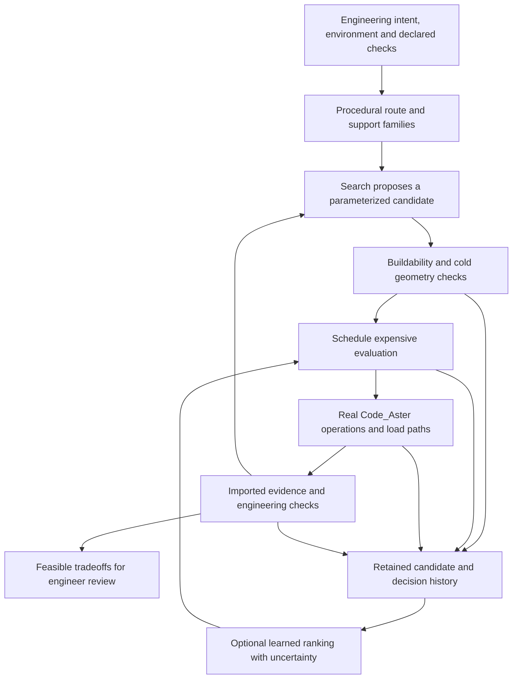

# Automated piping generation: research and direction for Tuba

Follow-up: the [direct-LLM assessment](direct-llm-piping-generation-research-2026-10-11.md)
revises this report's algorithm priorities. Use the
[LLM piping design roadmap](llm-piping-design-roadmap.md) for the current development sequence.

Date: 2026-10-11. Scope: industrial piping routes, thermal flexibility, supports,
and supporting steelwork. This is a research and product-direction report, not
an implementation plan or an engineering qualification. Recommendations below
are the author's synthesis; vendor capabilities and research results have
separate citations. No new Code_Aster evaluation was performed for this report.

## Recommended direction

Develop Tuba as an **explainable engineering design-search system for piping and
supports, with Code_Aster evaluating the physical behavior**. The near-term
application should be improving a hot line or a small piping assembly inside a
known corridor: select a route family, size its flexibility features, choose
support positions/types, and show the engineer several verified tradeoffs.

Use a hybrid of procedural engineering templates, geometric search, constrained
numerical optimization, and eventually learned screening. Prioritize the
representation of a buildable design and the completeness of its evaluation.
Algorithm choice matters, but a better optimizer cannot recover a missing nozzle
load check, an impossible support attachment, or an incorrect load path.

Evolutionary optimization has both academic and commercial precedent. Bentley's
current AutoPIPE page explicitly names a Genetic Algorithm Support Optimizer.
Its marketing also uses the terms AI and machine learning; those descriptions
alone do not establish a neural model trained across projects.
[AutoPIPE product page](https://www.bentley.com/products/autopipe/).

My suggested order is: reliable evaluation and benchmarks -> support/loop
optimization -> route-family search -> coupled rack/multiple-line design ->
surrogate-assisted search. LLM assistance can operate across these stages as a
proposal and explanation tool. Reinforcement learning is a later research option
whose training cost needs to be justified by repeated similar design tasks.

## What is already available commercially

The entries below establish advertised or documented capabilities. They are not
an independent comparative test, and vendor savings claims are not forecasts for
Tuba.

| Product or workflow | Evidence from its owner | Implication for Tuba |
| --- | --- | --- |
| AVEVA E3D Pipe Router | The versioned manual describes rule-based routing of single or multiple pipes, orthogonal paths, component placement, rack packing, and route controls. [Pipe Router manual](https://help.aveva.com/AVEVA_E3D_Design/2.1/PDUV/PDUV14.5.1.html), [routing rules](https://help.aveva.com/AVEVA_Everything3D/3.1/PDUV/PDUV14.5.2.html). | Automatic geometric routing and engineering rules are established capabilities. These manuals do not establish comprehensive stress-based optimization of every proposed route. |
| Aspen OptiPlant / OptiRouter | OptiPlant supports conceptual plant alternatives; OptiRouter connects to Smart 3D and E3D, reads equipment/structures, and routes to nozzles. A brochure says routing considers process/stress conditions and access/maintenance requirements. [OptiPlant](https://www.aspentech.com/en/products/engineering/aspen-optiplant-3d-layout), [OptiRouter](https://www.aspentech.com/en/products/engineering/aspen-optirouter), [brochure](https://home.aspentech.com/-/media/aspentech/home/resources/brochure/pdfs/fy26/q1/at-4686_brochure_optiplant_v4_112025.pdf). | A credible competitor in layout automation. The inspected material does not disclose enough solver/acceptance detail to establish equivalence to a complete Code_Aster evaluation of every candidate. |
| Bentley AutoPIPE Support Optimizer | Bentley documents support optimization using a genetic algorithm. Its technical knowledge base describes support locations/options, structural loads, displacement limits, and cost. The KB explicitly dates exclusions of nonlinear/dynamic analysis to August 2024. [Product page](https://www.bentley.com/products/autopipe/), [technical scope](https://bentleysystems.service-now.com/community/en?id=kb_article_view&sysparm_article=KB0038235). | The closest direct precedent for the first Tuba optimization product. The dated exclusion must not be asserted as a verified limitation of every current release. Whole-product analysis capabilities also cannot be assumed to apply to its optimizer. |
| CAESAR II | Hexagon documents an expansion-loop optimization wizard and exchange of analysis output for automatic support-component selection. [Loop wizard](https://aliresources.hexagon.com/videos-podcasts/caesar-ii-webinar-loop-optimization-wizard), [support interoperability](https://aliresources.hexagon.com/videos-podcasts/efficient-pipe-supports-data-transfer-with-caesar-ii). | Bounded engineering design assistants are useful products in their own right. These sources do not establish arbitrary whole-plant generative design. |
| CAEPIPE 3D+ | SST describes importing plant geometry, performing first-level flexibility/hot-interference checks, and returning design changes to the plant model, followed by detailed stress-engineer analysis. [CAEPIPE 3D+](https://www.sstusa.com/caepipe3d.php/maps/piping-videos.php). | Geometry/analysis interoperability and checking hot geometry already matter commercially. Tuba should make its automatic iteration and evidence inspectable, while supporting practical model handoff. |
| LISEGA LICAD | Uses parameters including diameter, temperature, operating load, travel, installation height, and configuration to select support assemblies; generates drawings/BOM and connects to CAD/CAE tools. [Support design](https://www.lisega.de/en/pipe-supports/licad-pg/), [current LICAD page](https://www.lisega.de/en/licad/). | A support must eventually map to an installable assembly with capacity and travel data. Optimizing ideal restraints alone stops short of construction design. Catalogue integration is a distinct task from selecting support locations. |

These products establish that automation is a real market. They do not prove
that a particular Tuba feature would be unique. A defensible positioning is the
combination of readable Python authorship, an open solver workflow, coupled
pipe/support behavior, and a retained explanation of every design decision.

## Academic evidence

Academic sources and their scope are summarized below. Publication dates come
from the papers/publisher records, not search-engine crawl dates. Where only an
abstract was inspected, that limits the conclusions drawn.

| Study | Demonstrated approach | Scope and relevance |
| --- | --- | --- |
| Niu et al. (2016), [Ship Pipe Routing Design Using NSGA-II and Coevolutionary Algorithm](https://onlinelibrary.wiley.com/doi/10.1155/2016/7912863) | Maze initialization, multiobjective genetic search, and branch coevolution; objectives include length, bends and shared paths. | Full text reviewed. Strong precedent for combining graph/grid routing with evolutionary search. The presented routing evidence does not establish thermal, nozzle-load or piping-code acceptance. |
| Belov et al. (2017), [3D routing with flexibility constraints](https://research.monash.edu/en/publications/an-optimization-model-for-3d-pipe-routing-with-flexibility-constr/), [author-hosted paper](https://researchmgt.monash.edu/ws/portalfiles/portal/257708132/93759696_oa.pdf) | Constraint programming for LNG piping, clearance/support zones, and rerouting against flexibility constraints. | Paper reviewed. The thermal calculation uses the approximate Guided Cantilever Method with rectilinear geometry and fixation at nozzles. Very relevant decomposition, with a substantially narrower mechanics model than a general FE evaluation. |
| Rapo et al. (2019), [Pipe route optimization to avoid undesired vibration by using JuliaFEM](https://oulurepo.oulu.fi/handle/10024/26184?show=full) | Natural frequencies evaluated by FE within a route-optimization loop, using JuliaFEM and JuMP. | Institutional abstract and indexed paper inspected. High-pressure fuel-pipe vibration case; evidence for mechanics inside the loop, not general process-piping qualification. |
| Gao et al. (2020), [Neural surrogate and GA for clamp layout](https://www.mdpi.com/2076-3417/10/1/390) | Sensitivity analysis informs FE sampling; a neural network approximates response; GA changes clamp location/orientation. | Publisher-indexed methods/results inspected. Aviation Z-tube and experimental comparison. A useful bounded-family ML precedent. The paper notes experimental stress-location differences; comparison with experiment is not proof of uniform stress-prediction accuracy. |
| Liu et al. (online 2020 / issue 2021), [PSO for multi-hoop support layout](https://journals.sagepub.com/doi/abs/10.1177/0954406220947115) | FE with support stiffness and particle-swarm search moves supports to avoid excitation frequencies. | Publisher abstract reviewed. A single-pipe modal problem supports PSO as a placement alternative; it does not establish whole-plant routing capability. |
| Caponetto et al. (2022), [Pressure-piping revamping with neural networks](https://www.mdpi.com/2411-9660/6/6/103), [institutional paper](https://www.iris.unict.it/retrieve/5c86aa9c-af40-4364-ac0c-81ebe02327b3/designs-06-00103.pdf) | CAESAR II data train an ANN for a bounded expansion-loop design problem; the revised design is checked again using FE. | Publisher/institutional indexed text reviewed. Particularly relevant to hot process piping. The case uses 125 samples and three variables, including wall thickness; it does not establish prediction across arbitrary layouts. The reported design reduces loop count, but that is not an expected universal saving. |
| Liu et al. (2022), [Adaptive ant-colony pipe routing](https://www.sciencedirect.com/science/article/pii/S0950705121010339) | Changes to directional heuristics and pheromone updates for route search, with a semisubmersible example. | Publisher abstract reviewed. The reported problem comparisons are 2D. ACO is a real routing research family, with separate work needed for 3D fabrication and stress constraints. |
| Kim et al. (2023), [Curriculum reinforcement learning for ship routing](https://academic.oup.com/jcde/article/10/1/318/6972374) | PPO with curriculum learning and local sensing, compared with graph-search and earlier RL approaches. | Full text reviewed. The model uses 90-degree turns and ignores pipe thickness. This is evidence for a route proposal policy, not a finished engineering design. |
| Sun et al. (2025), [Multiobjective nuclear-piping support layout](https://epjournal.csee.org.cn/en/article/doi/10.19805/j.cnki.jcspe.2025.230593/) | FE plus NSGA-II for support layouts; two examples examine mechanical performance and support count, reporting stress below RCC-M limits. | Journal abstract and indexed English abstract in the original paper inspected. A close precedent for the proposed Tuba support optimizer. Full methods and nuclear-code qualification were not independently evaluated. |
| Wang et al. (2025), [Self-learning free-form aeroengine routing](https://arxiv.org/abs/2504.03669) | PPO, layout-rule modeling, and NURBS paths, including adaptation after environment changes. | Author-preprint abstract reviewed. Reported comparisons cover geometry, rules and computational efficiency; mechanics acceptance is not established by that evidence. |
| [Multi-agent DRL for ship pipelines (2026)](https://www.sciencedirect.com/science/article/pii/S2092678226000543) | D3QN with alternating decisions to coordinate multiple routes. | Publisher abstract reviewed. Shows research moving beyond a single pipe; the inspected evidence does not establish integrated stress/code evaluation. |
| Wang et al. (2026), [Manufacturing-aware RL for aeroengine pipes](https://arxiv.org/abs/2605.20644) | Curvature/torsion representation, manufacturing constraints, PPO, and conversion to six-axis free-bending trajectories. Authors report physical fabrication. | May 2026 author-preprint abstract reviewed. Stronger manufacturing evidence than geometric clearance alone. Free-bent tubing and catalogue-elbow plant piping are different domains; the reported fabrication does not establish process-piping stress qualification. |

The evidence supports three distinct uses of optimization: generate a path,
optimize a mechanically evaluated design, and learn an approximation that makes
the search cheaper. They can be combined, but their validation claims should
remain separate. Genetic algorithms and PSO can operate without a trained ML
model; a neural surrogate learns from prior evaluations; RL learns a policy from
repeated interaction. An LLM is a further, different proposal mechanism.

Two additional strands matter when "piping structure" includes the rack and
multiple connected lines:

- Guirardello and Swaney (2005) decompose plant layout and routing, using MILP
  and graph shortest paths. The abstract discusses routing capacity and scale
  tradeoffs, and mentions stress analysis in the shortest-path approach. It is
  evidence for decomposition, not evidence that one monolithic optimization is
  practical for arbitrary plants. [Publisher abstract](https://www.sciencedirect.com/science/article/pii/S0098135405001985).
- Zakian, Ordoubadi, and Alavi (2021) optimize steel pipe-rack weight with PSO,
  GWO, and IGWO, selecting discrete available sections under stress-ratio, drift,
  and dimensional constraints. This is structural member sizing; the inspected
  abstract does not establish joint rerouting and nonlinear pipe/rack design.
  [Publisher abstract](https://journals.sagepub.com/doi/10.1177/13694332211004116).

## Which methods fit which task

The priorities in this table are recommendations for Tuba, not a ranking proved
by the cited papers.

| Method | Suitable role | Main limitation | Priority |
| --- | --- | --- | --- |
| Rules, construction units, graph search/A* | Legal route families, corridors, endpoint approaches, clearance, buildable fittings | A short collision-free path says little about thermal flexibility or nozzle loads | Keep and strengthen now |
| Enumerated grid / space-filling sampling / local search | Transparent baseline; small loop/support parameter spaces; local repair of an existing design | A grid scales poorly with parameter count | Establish the comparison baseline |
| Mixed-variable GA / NSGA-II | Support presence/type, corridor/loop family, catalogue sections, and dimensional tradeoffs | Many evaluations; needs design-aware mutation/repair and diversity | First general optimizer |
| Differential evolution | Bounded dimensions and support stations within a fixed topology | Categorical topology needs another representation; can consume many evaluations | Useful simpler comparator |
| MILP / constraint programming | Finite routing graphs, corridor occupancy, rack allocation and support selection when the constraints can be expressed appropriately | Nonlinear FE mechanics cannot simply be embedded as linear constraints | Add for a demonstrated discrete bottleneck |
| Bayesian optimization / active learning | Choose valuable expensive FE evaluations in a moderate-size parameter space | Surrogate quality near contact transitions and on unfamiliar designs is uncertain | First ML investment after data/benchmarks |
| RL / imitation learning | Repeated route generation or choosing repair moves across many similar problems | Training distribution, reward design and total simulation cost | Later research track |
| LLMs | Translate design intent into reviewed parameters, propose procedural units, retrieve prior patterns, explain recorded checks | Text plausibility does not establish engineering validity | Assistant around the evaluator |
| Continuum topology optimization | Specialized new bracket/component concepts | Stock piping, fitting catalogues, weld access and constructability require a different design representation | Separate component-research track |

For implementation reuse, **pymoo** already documents binary, integer, real and
categorical variables, mixed-variable mating, and multiobjective survival.
Its feasibility-first approach is a useful starting point for constrained
selection. Tuba still owns its evidence verdict and treatment of unknown checks.
[Mixed variables](https://pymoo.org/customization/mixed.html),
[NSGA-II](https://pymoo.org/algorithms/moo/nsga2.html),
[feasibility first](https://pymoo.org/constraints/feas_first.html).

**SciPy differential_evolution** supports bounded optimization, constraints,
integer variables, and worker-based evaluation. Its own documentation warns of
the potentially large number of objective evaluations. Use it for an isolated
dimension-search comparator, not as proof of global optimality.
[SciPy documentation](https://docs.scipy.org/doc/scipy/reference/generated/scipy.optimize.differential_evolution.html).

**BoTorch** provides multiobjective Bayesian optimization; its tutorials show
constrained closed-loop selection. Treat acquisition-function choice as a
versioned implementation decision. **OpenTURNS** provides experimental design,
surrogates, sensitivity, and uncertainty tools. These are useful libraries, not
ready-made qualified piping optimizers.
[BoTorch overview](https://botorch.org/docs/v0.16.0/multi_objective),
[constrained tutorial, version 0.13](https://botorch.org/docs/v0.13.0/tutorials/constrained_multi_objective_bo),
[OpenTURNS](https://openturns.github.io/www/?subwindow=home).

SALOME YACS already supports iterative and parametric calculation graphs. It is
adjacent infrastructure to learn from, not a reason to replace Tuba's native
Python evaluator or its external-process Code_Aster bridge.
[YACS principles](https://docs.salome-platform.org/latest/gui/YACS/principes.html).

## Proposed engineering architecture

The learned ranker changes scheduling. It cannot authorize acceptance or turn an
unevaluated design into a measured failure. Geometry rejected before solving
retains its actual geometric reason. A missing solver, failed convergence, or
missing required result retains an evaluation/availability status.

**Represent engineering choices directly.** A candidate should contain a route
family/corridor, loop dimensions and placement, support attachment slots,
support type/orientation, guide gap, and selected rack sections where those are
in scope. Use meaningful procedural Python and JSON-serializable parameters.
Generate nodes/elements as derived state. Reserve custom construction units for
project-specific geometry; do not grow core assemblies with each special case.

Start with fixed equipment/nozzles, fixed pipe specification, explicit support
attachment zones, and a small number of route families. Do not let the search
silently change pressure, temperature, wall thickness, equipment stiffness, or
acceptance limits to find an easier problem. Broader co-design can expose these
as approved variables later, with the additional hydraulic/process checks.

**Separate hard requirements and preferences.** Mandatory geometry, required
operations, nozzle force/moment criteria, displacements, support capacities,
hot clearances, and project-owned standard checks gate feasibility. Cost,
installed length, fittings/welds, support count, steel mass and project-defined
margin can then describe tradeoffs. Present a small set of nondominated choices:
a choice is nondominated when no other retained feasible design is at least as
good in every declared objective and strictly better in one. The engineer chooses
the balance.

Do not reduce six-component nozzle acceptance to a universal resultant force
limit. Components, moments, coordinate frames and any interaction formula must
come from the equipment/project criterion. Likewise, FE von Mises output cannot
silently become a piping-code stress ratio. Tuba's current policy keeps piping
standard evaluators project-owned.

**Search the coupled route/support problem.** Moving a guide, changing a loop,
or changing rack stiffness can alter the load distribution. Begin with
alternating route and support improvements if that makes computation manageable;
always reevaluate the complete candidate before retaining it as feasible. Add
catalogue assembly geometry, installation access, and attachment capacity as
those contracts become available.

**Spend fidelity deliberately.** Reject impossible geometry cheaply. Use the
qualified Code_Aster line/pipe model for the global evaluations appropriate to
that model's scope. Refine selected candidates and critical connections with the
required nonlinear states, mesh studies or local solid models. Different
fidelities must have different evidence labels. A coarse result cannot establish
a fine-model requirement without a justified qualification.

Code_Aster's SSLX102 validation case covers TUYAU bending and ovalization
transmission, including shell/pipe and 3D/pipe coupling. This is relevant
verification material for Tuba's modeling work; it does not automatically
validate Tuba's exported studies or every piping component.
[Code_Aster SSLX102](https://code-aster.org/doc/v17/manuals/man_v/v3/v3.05.102/index.html).

**Budget solver calls before choosing a population size.** As an illustrative
calculation only: 1,000 candidates, three separately solved operations, and two
minutes per operation require 3,000 invocations and 100 hours if run sequentially,
before geometry, import and review overhead. These are assumed values, not Tuba
measurements. Measure actual costs, deduplicate exact solver inputs, bound
concurrency and memory, and use an explicit evaluation budget.

## How machine learning should enter

The first useful learned component is a model that estimates which candidate
deserves a real evaluation next. Candidate targets include nozzle reactions,
displacements, selected utilization measures, likely feasibility, and evaluation
cost. Geometry and operating context must accompany the labels: section,
material, temperature/pressure, endpoint stiffness, topology, support locations
and types, and actual load-path definition.

For a small fixed route family, test a Gaussian-process surrogate. For more
heterogeneous mixed variables, compare other regression/ranking models rather
than assuming one architecture will generalize. Choose new solves using both
predicted improvement and uncertainty, and retain exploration of designs the
model dislikes. A low prediction is a scheduling rationale, never an observed
engineering rejection.

Use the retained search history as a future dataset, with these safeguards:

- Keep measured failures as well as successes; store operation, constraint,
  value, limit, units, location, solver/model version and evidence identity.
- Store solver/runtime/convergence failures separately from physically failed
  constraints. Missing, pruned and interrupted results are not negative labels.
- Split evaluation by project, geometry family or run. Nearby siblings from one
  search placed randomly into train/test sets can make generalization look
  stronger than it is.
- Measure false-feasible predictions, missed promising candidates and ranking
  quality near limits, alongside average prediction error.
- Detect unfamiliar parameter/topology ranges and revert to real evaluation.
  Preserve an exploration quota to expose selection bias in the learned model.
- Recompute final selected candidates with the required Code_Aster settings and
  all required operations/checks. Predictions remain separately labeled.

RL could later learn where to insert a loop or which support change to try.
First compare it with deterministic repairs, random/space-filling search and
evolutionary search under the same online budget; report offline training cost
separately. Training on geometry-only episodes cannot establish stress-aware
behavior. An LLM can propose a new construction unit or search family now, but
the ordinary build, clash and solver gates must evaluate that proposal.

## Fit with the current repository

The main checkout was inspected at `dc2131d6e018d86f9c462f55d8961d1d84363e5e`.
It already contains deterministic A* routing, explicit candidate application,
U-loop generation, and the Code_Aster scorer. The older `AutoroutingAgent`
defaults to export-only operation; its selected geometric candidate is not a
complete engineering acceptance. The scorer does not enforce all declared
nozzle/displacement/operating-clearance criteria.
[Routing manual](../content/autorouting.md),
[expansion scope](expansion-aware-autorouting.md),
[agent implementation](../../tuba/routing/agent.py),
[scorer](../../tuba/routing/solver_loop.py).

The separate worktree `D:/Gitprojects/Tuba_v4-search-history-20261010`, on
`codex/piping-search-history-20261010`, was inspected at HEAD `5dae6c4` with
uncommitted ongoing film/search changes. Its current files contain `tuba.search`,
a deterministic parameter grid, retained attempts/evidence, structured checks,
and replay. Its selection is lexicographic, not a Pareto-front optimizer. That
work is not in the inspected main HEAD. These are source/document observations,
not a fresh runtime qualification. No changes were made in that worktree.

The existing [search roadmap](piping-search-roadmap.md) is strongly aligned with
this research. Build the numerical strategy layer around that evaluator/history
contract, subject to its own integration and validation, rather than attaching
engineering acceptance to the older scorer's `is_valid` flag. Preserve both
rejected candidates and their measured reasons. Keep replay in the existing
web-scene viewer.

This recommendation does not restore the retired built-in ASME implementation.
Project-owned engineering evaluators must explicitly define any standard checks
needed by a benchmark or customer workflow.
[Current standards policy](b31j-compliance-migration.md).

## Development sequence and evidence for each step

| Step | Concrete deliverable | Evidence required before extending scope |
| --- | --- | --- |
| 1. Qualified baseline | One hot-line project with fixed corridor/nozzles/specification, allowed supports, explicit operations and frozen checks | Real solved rejection and feasible case; trusted result import; independent review of boundary conditions and check meanings; existing grid history retained |
| 2. Support and loop optimizer | Mixed-variable GA/NSGA-II adapter; dimensions/support stations/types; buildability repair; retained nondominated feasible designs | Comparison with grid, space-filling/random and local search under equal solver/time budgets; repeated seeds; no selection with unknown required checks |
| 3. Route-family and repair search | Alternative corridors, offsets/loop families where implemented, feasible attachment regions, engineering-sized mutation moves | Improvement on held-out layouts; genuine topology diversity; all shortlisted candidates evaluated through the same complete gate |
| 4. Rack and multiple-line coupling | Shared rack sections/capacities, interaction-aware support changes, coordinated routing and rerouting | Full assembled-model evaluations, shared-load checks, declared operation combinations, constructability and attachment review |
| 5. Learned evaluation scheduling | Surrogates plus uncertainty, active sampling and an explicit fallback | Lower total solve cost for comparable verified solution quality on unseen projects; prediction errors and offline costs reported |
| 6. Repeated-task learning | Optional RL or learned repair policy for a clearly recurring domain | Beats simpler methods after counting training, failures and deployment distribution shifts |

Steps 3-5 can overlap once the evaluation contract is stable. If measured solves
are particularly expensive, promote surrogate scheduling earlier. If dozens of
evaluations are cheap, a simpler evolutionary/local search may remain preferable.
The table defines dependency order, not calendar estimates or guaranteed gains.

The first comparison should include an engineer-authored baseline and several
deliberately different cases: an expansion-sensitive hot line, a nozzle-load
limited line, a clearance-limited route, and a support-layout problem. Introduce
friction/lift-off and shared-rack cases only with the necessary validated model
and load-path treatment. Include multiple seeds for stochastic strategies and
report distributions rather than only the best run.

Measure time/solver calls to the first feasible candidate, objective quality
versus evaluation budget, counts of feasible/incomplete/failed evaluations,
geometry-repair and duplication rates, and retained bytes. For multiobjective
comparisons, use a declared common objective normalization/reference point and
measure coverage of the verified tradeoff set. Record wall time, concurrency and
hardware so that apparent speedups are interpretable. Keep training cost
separate from per-project search cost.

Preserve small source/configuration manifests and the complete required search
evidence outside tracked source. Reuse compatible environments and unchanged
assets. Do not create a source archive per candidate. Storage exhaustion should
stop scheduling with an explicit reason, not silently erase rejected results.

## Research boundaries

This was a targeted broad review of primary vendor documentation, research
papers/publisher abstracts and official library documentation. It was not a
systematic literature review, hands-on commercial product comparison, licensing
audit, or validation of reported speedups. Several papers concern ship or
aeroengine routing; transferring those results to industrial hot piping needs
new experiments. Source code, datasets and reproducible complete benchmarks
were not established for every cited method. No claim is made that one algorithm
is universally best or that a global engineering optimum has been found.

The next development decision I recommend is a **solver-budgeted comparison of
support/loop search strategies on the retained-search evaluator**, starting with
the existing deterministic baseline and adding a mixed-variable evolutionary
strategy. That experiment will produce both useful piping designs and the
evidence needed to decide whether ML should be the next investment.

For a compact reading sequence, start with the 2022 pressure-piping ANN case,
the 2025 FE/NSGA-II support paper, the 2017 flexibility-constrained routing paper,
and the 2026 manufacturing-aware RL preprint in the evidence table. Together they
show the practical opportunity and the limits of transferring geometric search
results into a qualified engineering workflow.
