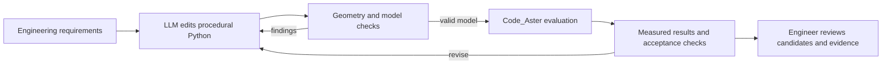

# Direct LLM design for Tuba piping

Research date: 2026-10-11. This follow-up revises the algorithm priorities in
[the broader piping-generation report](automated-piping-generation-research-2026-10-11.md).
The accepted development sequence is now captured in the
[LLM piping design roadmap](llm-piping-design-roadmap.md).
It recommends an experiment, not a production qualification. No new piping
design, Code_Aster evaluation, or optimizer comparison was run for this report.

## Recommendation

**Test an LLM as the primary design and search agent now. A genetic algorithm
does not need to be implemented first.** Let a capable coding agent author and
revise Tuba's procedural Python, run geometric checks and Code_Aster, interpret
the measured findings, and propose the next design.

The earlier report gave evolutionary optimization too much priority and the LLM
too narrow a role. Direct LLM iteration with finite-element feedback already has
research precedent. Tuba's Python authoring and inspection/solve interfaces make
this a particularly appropriate experiment. Success on complex piping remains
to be measured; the literature does not establish that classical optimizers are
obsolete.

The durable product investment is a precise model interface, dependable
evaluation, useful feedback, and retained design history. Each improvement in
the underlying coding model can then improve the designer without requiring a
new domain-specific neural network or a new optimization architecture.

## What the evidence actually demonstrates

The distinctions below matter: an LLM can directly select the next design,
write a small optimizer, or supervise an existing optimizer. All three can be
useful, but they are different claims.

| Primary source | What the LLM does | Evidence boundary |
| --- | --- | --- |
| Jadhav and Farimani, [Large language model agent as a mechanical designer](https://doi.org/10.1080/09544828.2026.2624356), online February 2026; [public preprint v3](https://arxiv.org/abs/2404.17525v3) | Directly proposes and revises 2D trusses using FEM feedback, without domain-specific fine-tuning. | Authors report fewer evaluations than NSGA-II. The accessible preprint's section 4.4 describes a GA baseline that lacks a physical-feasibility representation and can produce disconnected/degenerate designs. This supports direct LLM design, but does not establish superiority over a carefully constrained GA. Publisher abstract and public preprint were inspected; the final journal full text was not accessible. |
| Lee, Kim and Jung, [Multi-agent LLM framework integrating CAD, FEA, and optimization](https://doi.org/10.12989/sem.2025.96.6.523), 2025; [full paper](https://www.techno-press.org/download.php?journal=sem&num=6&ordernum=6&volume=96) | GPT-5 updates JSON design parameters from FE outputs, target deviations, and history. Section 2.5 explicitly uses the LLM instead of a numerical optimization algorithm. FreeCAD, Gmsh and ANSYS perform downstream work. | Four examples include a flanged pipe. No task-specific fine-tuning; simple geometries and linear structural analysis. The authors acknowledge reduced robustness for complex cases. This is directly relevant precedent, not validation of thermal piping networks. |
| Mallis et al., [CAD-Assistant: Tool-Augmented VLLMs as Generic CAD Task Solvers](https://arxiv.org/html/2412.13810v3), revised August 2025 | A pretrained vision-language planner writes Python against FreeCAD and uses tool feedback to continue the task. | Demonstrates CAD tool use without training the planner for each task. Benchmarked sketch/CAD tasks and qualitative generation examples do not establish structural acceptance. |
| BenchCAD team, [Frontier Models Reconstruct 3D by Hill-Climbing a 2D Proxy](https://benchcad.com/blog/2d-proxy), October 6, 2026 | Coding agents generate CAD; inspected runs also write rendering, measurement, and optimization code themselves. | Supports an agent choosing computational tools during design. Selected failures include a nearly solid elbow where a hollow part was required. Geometric similarity is an incomplete engineering objective. Quantitative harness comparisons concern one model; newer-model examples are not equivalent comparative trials. |
| Kong et al., [A method for pipe auto-routing using an LLM-based expert system](https://www.sciencedirect.com/science/article/pii/S2092678226000609), 2026; [author-lab publication record](https://sydlab.snu.ac.kr/journal/2026-08-12-00/) | Agents assess routing results and adjust A* cost weights to improve subsequent routes. | Actual piping research, but A* generates the paths. The inspected abstract reports geometric/layout improvements, not comprehensive FE stress or piping-code acceptance. The author lab dates publication August 12, 2026. |
| [BlenderGym](https://blendergym.github.io/), CVPR 2025 | Evaluates foundation-model systems editing scenes across geometry, lighting, materials, and other graphics tasks. | Relevant to the user's Blender analogy, but graphics editing is not an engineering-validation benchmark. Its older model cohort cannot establish the limits of current frontier models. |

Two further sources help interpret the landscape. The August 2026
[semantic pipe-routing preprint](https://papers.ssrn.com/sol3/papers.cfm?abstract_id=7299984)
turns language into geometric search priors rather than relying on direct
coordinate generation. It is an example of a hybrid research choice, not proof
that newer coding agents cannot author routes. The current
[Parametric CAD Benchmark](https://cadbench.ai/) includes creation, subsequent
editing, and drawing-based tasks; its aggregate reward scores are not the
percentage of designs that are fully correct or engineering-qualified.

Taken together, these sources justify trying direct LLM design now. They do not
yet answer whether it is more reliable or economical than numerical search on
Tuba's own piping problems. There is no inspected study establishing general
autonomous generation of fully qualified industrial piping with all relevant
operating cases, supports, connections, and fabrication constraints.

## How to use it in Tuba

The appropriate analogue to Blender's Python interface is Tuba's authored
`model.py` and reusable construction units. The agent should edit meaningful
engineering code: route segments, loops, supports, dimensions, and assembly
calls. It should not hand-author the compiled node/element dump.

The current [README](../../README.md) already describes agent authoring,
`inspect_model`, `verify_model`, `check_clashes`, and `solve_model`. The
[project-folder ADR](../adr/0003-agents-and-engineers-meet-at-the-project-folder.md)
also provides the shared artifact model. These are useful foundations; this
research did not execute or qualify their runtime behavior.

The LLM can choose a different routing concept, add a flexibility loop, alter a
support arrangement, or synthesize a construction unit. This is a larger action
space than changing a vector of dimensions inside a fixed template. It is also
why comparisons need to distinguish design creativity from efficient parameter
tuning.

For example, a useful feedback item would identify the actual failing nozzle,
load case, force or moment component, measured value, unit, limit, and candidate
artifact. The agent can then propose a geometry or restraint change and test it.
The explanation is a hypothesis; the subsequent calculation determines whether
the change helped. A stress plot or a single combined score alone is usually
insufficient to diagnose which change to try.

The experiment should establish these boundaries:

1. **Keep requirements outside the agent's editable design.** Fix equipment
   interfaces, load cases, temperature, material assumptions, required checks,
   and acceptance limits for the task. The agent must not achieve a pass by
   silently changing the problem. Explicitly authorized engineering changes can
   define a new problem version.
2. **Return structured findings.** Include stable component IDs, locations,
   units, load cases, margins, collision pairs, and evidence references. Use
   scene views for spatial understanding alongside the numeric feedback.
3. **Preserve alternatives and their actual outcomes.** Keep source changes,
   parameters, solve attempts, measured failures, rejected feasible options,
   and the selected result. A failed or interrupted evaluation is not proof
   that a design is physically infeasible.
4. **Tie evidence to the evaluated candidate.** Changed geometry or study
   settings need matching evaluation evidence. Final acceptance requires all
   applicable checks, including operating-state effects where required. Export
   generation and agent-written estimates are not completed evaluations.
5. **Bound each run.** Set wall-clock, model-call, and solver budgets; detect
   repeated candidates and retain the best verified feasible option. Report
   an unresolved task honestly if none is found.

These are proposed experiment requirements, not claims that every safeguard is
already implemented. Start with one coding agent and its tools; multiple
specialized agents are an optional later comparison.

## What remains useful from classical optimization

Classical algorithms can be tools the agent uses when they suit the problem:

| Situation | Useful approach to test |
| --- | --- |
| A new layout concept, interpretation of engineering intent, or an unfamiliar repair | Let the LLM propose procedural designs and iterate from measurements. |
| Finding a collision-free path through a dense routing corridor | Offer graph search such as A* as a callable tool if direct route generation struggles. |
| Fine adjustment of several dimensions after the layout is settled | Offer a bounded parameter sweep or local optimizer; compare its cost with additional LLM turns. |
| Many repeated support combinations or a broad set of cost/performance tradeoffs | Benchmark evolutionary or other numerical search if agent runs show poor coverage or reliability. |
| Many expensive evaluations in a recurring design family | Consider surrogate models only after accumulating suitable evaluated data and measuring the benefit. |

These are engineering hypotheses, not results from a Tuba comparison. It is
reasonable for an LLM to write a small search script itself, as the CAD evidence
illustrates. That can remove the need to prebuild a large optimization framework
while still taking advantage of numerical methods. There is no benefit in
forbidding an effective tool merely to label the system purely LLM-based.

## The next experiment

Use a small, reproducible suite spanning a clash repair, a hot line with
flexibility/nozzle-load limits, a support-placement task, and a coupled
pipe/support example. Specify the engineering scope of each case explicitly.
Include both a fixed design family and a case permitting layout changes.

Compare three practical configurations:

- A coding LLM with authoring, inspection, geometric checks, and real Code_Aster
  feedback; no separately implemented optimizer is required.
- The same agent with optional geometric search and bounded numerical tools.
- An existing deterministic search or manually designed reference. Add a
  properly constrained GA comparator when it can answer a specific question,
  rather than making it a prerequisite for the first trial.

For a controlled algorithm comparison, use identical design bounds and
acceptance checks. Evaluate broader program synthesis separately; allowing one
method to change topology while another has a fixed representation confounds
the comparison. Make invalid geometry and missing evaluations visible in the
results instead of silently excluding them.

Measure verified feasibility rate, time to the first feasible design, final
engineering objectives, solver evaluations, total wall time, model cost, and
repeatability. Count failed attempts and compare under both solver and overall
time budgets. Pin the model version, prompt, tools, study, and starting design;
repeat runs instead of selecting a successful demonstration. Review whether
the generated Python remains understandable and maintainable.

If the direct agent performs well, develop that experience first. If it
repeatedly struggles with dense routing, numerical fine tuning, or alternative
coverage, add the corresponding algorithm and measure the change. The proposed
development order is therefore **agent experiment and reliable feedback first;
specialized search where observed failures justify it**.

## Review scope

This report combines primary-source research with a read-only inspection of
Tuba's current documentation and agent interface. Paper demonstrations,
benchmark results, and proposed Tuba behavior are identified separately.
Published numerical improvements are not forecasts for this project. No new
solver results, speedups, code-compliance claims, or runtime validation are
asserted.
