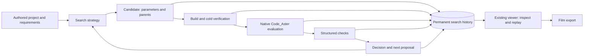

# Explainable piping-layout search roadmap

Date: 2026-10-10

Status: M1 implemented and qualified on the hot-line example with real Code_Aster; M2 interactive replay implemented and validated against its retained native artifacts. M3-M5 remain planned.

Implementation baseline: `7652065e1637e5c7ab102cb2ceb5236a3d4a92b6`

## Intended outcome

Tuba should help an engineer search for a piping layout by proposing routes and
support arrangements, evaluating them with Code_Aster, checking the specified
requirements, and retaining a reviewable selection. Every attempted candidate,
including rejected candidates, should remain inspectable. The same history should
drive an interactive replay and, subsequently, a film of the search.

The first implementation is described in
[the initial implementation plan](../superpowers/plans/2026-10-10-piping-search-history.md).
This roadmap defines the longer-term direction; its later milestones are separate
implementation projects.

M2 is documented in [the replay implementation plan](../superpowers/plans/2026-10-10-piping-search-replay.md)
and [the interactive replay guide](../content/piping-search.md#interactive-replay).

## Product constraints

- Python support remains `>=3.11,<3.15`.
- The engineering workflow remains Tuba model -> Code_Aster solve -> processed-result display.
- Authored `model.py` scripts remain procedural Python and are never overwritten by search.
- Code_Aster execution remains native Tuba code using an external solver process; prefer the Python-managed bridge.
- Export-only studies, predictions, proxy calculations and test fixtures are never presented as engineering solver results.
- Feasibility is always scoped to the declared checks, operations, modelling assumptions and evidence; it is not a claim of full piping-code compliance.
- Applicable piping-standard checks remain user-owned; this roadmap does not restore the retired built-in ASME evaluator.
- Search replay uses `tuba/visualization/` and `viewer/`; it does not introduce another rendering path.
- Required check outcomes are `pass`, `fail`, `unknown` or `not_applicable`; missing evidence cannot establish a pass.
- Source changes and small final deliverables belong in Git; histories, solver artifacts, generated scenes and films belong in durable storage outside tracked source.
- Commit locally by default; never push without an explicit user request.

## Current implementation and gaps

The baseline already has geometric routing, U-loop candidates, model verification,
Code_Aster export/execution/import, solver-input identities, operating-state clash
checks and browser scene bundles. Reuse these modules:

| Existing owner | Responsibility to retain |
| --- | --- |
| `tuba/routing/astar.py`, `hybrid.py`, `expansion.py`, `adapter.py` | Geometric alternatives and explicit application to a model |
| `tuba/verify.py`, `tuba/project/solve.py` | The cold-model gate and ordinary project evaluation |
| `tuba/project/study.py`, `freshness.py` | Validated study settings, compiler selection and expected solver inputs |
| `tuba/solver/aster.py`, `tuba/analysis/code_aster_artifacts.py` | Real execution and artifact import |
| `tuba/analysis/provenance.py`, `tuba/project/evidence.py` | Solver-input identity and the established evidence verdict |
| `tuba/clash/`, `tuba/analysis/contact_findings.py` | Spatial findings and load-path findings |
| `tuba/visualization/`, `viewer/` | Scene contracts and review rendering |

`AutoroutingAgent` is currently a candidate-generation/scoring harness, not a
complete multi-operation engineering optimizer. Its defaults permit export-only
operation and nonfatal solver diagnostics; candidates outside its solver budget
can remain geometrically selectable. Nozzle/displacement/hot-clearance criteria
are not enforced there, and a thermal requirement does not automatically size a
qualified loop. The new search must have its own explicit complete-evaluation
gate rather than interpreting `candidate.is_valid` as engineering acceptance.

Ordinary project evidence is current-state storage: `promote_evidence` replaces
operation files, and `solve_project` removes staging in `finally`. Preserve that
contract. Search attempts need independently owned, durable output directories,
including when a solver, importer or subsequent check fails.

## Architecture

The evaluator must work without an LLM. Search strategies propose legal changes
and consume measured feedback; they cannot waive requirements or manufacture a
solver result. Start with a deterministic parameter grid. Add numerical and
agent-driven strategies only after they can be compared against that baseline.

Separate discrete choices, such as corridor or loop family, from dimensions and
support positions within a chosen arrangement. A layout representation should
use authored builder functions and construction units, with meaningful parameters
and bounds. Archive compiled geometry as derived state for inspection, not as a
replacement for authored Python.

Find feasible candidates before selecting among their length, bend count,
support requirements and other declared objectives. Retain useful tradeoffs
rather than collapsing all engineering failures into one opaque cost penalty.
When no candidate is feasible, show the observed violations and remaining
unknowns; there is no selected engineering solution.

## Permanent records and identities

Use a local SQLite database with append-only events and a filesystem artifact
store initially. A remote service or distributed queue is not a prerequisite.
Write artifacts completely before committing events that advertise a completed
evaluation. Crash recovery must preserve partial output and append an interruption
record instead of creating a false success.

| Record | Required information |
| --- | --- |
| Search run | Source/dependency snapshot, search configuration, criteria/objectives, strategy/version, budgets, runtime provenance and start time |
| Candidate | Unique ID, parent IDs, proposal order, exact JSON parameters, intended change and full design/environment digest |
| Evaluation attempt | Unique ID, candidate, operation/load path, modelization/mesh, runtime, status, timings and owned artifact directory |
| Check result | Constraint/version, required/advisory role, verdict, operation/increment, entity references, evidence, measurement/limit/comparator/units and diagnostics |
| Decision | Evaluation references, outcome/reason codes, governing failure, other observed failures, unexecuted checks and any comparison candidate |
| Event | Monotonic sequence, UTC timestamp, producing worker and causal references |

Each proposal has its own ID even when it duplicates an earlier design. Retries
have new attempt IDs; rechecking old results under changed limits has a new
evaluation ID. Decisions at the time remain readable after later reevaluation.

Maintain separate identities for the complete design/environment, the exact
solver inputs and the acceptance policy. An obstacle move can invalidate clash
checks without changing the structural solve. A support change invalidates the
solve. A changed acceptance limit can reuse valid solver evidence but must produce
new check results. Retain exact source bytes and dependency/asset digests, not
only a Git SHA. Do not promise identical new solver executions or agent proposals
from a seed; historical replay uses the recorded outputs.

Native IDs may repeat between candidates and operations. Historical references
must therefore include their candidate/attempt/result-state scope. Keep semantic
associations to authored units, routes and stations where available, and retain
the exact candidate-local entity ID used by the solver or clash engine.

## Explaining every outcome

| Outcome | Explanation and evidence |
| --- | --- |
| `rejected_constraint` | At least one required check failed; identify it, its scope, evidence and violation |
| `evaluation_failed` | Build, export, meshing, runtime, convergence, import or checker execution failed; preserve available diagnostics |
| `incomplete` | Required operations or evidence are absent/unverified, or required checks remain unknown |
| `feasible_retained` | All required checks passed or have an explicitly justified non-applicability; no selection claim yet |
| `feasible_not_selected` | Passed the declared checks; give objective values and the comparison or authored tradeoff that decided selection |
| `duplicate` | Link to the matching design/evaluation and state what was reused |
| `deferred` / `pruned` | State the scheduling, budget or prediction-based reason, and the checks not executed |
| `selected` | Complete evidence, passed requirements, governing comparisons and the final selection rationale |

A solver failure is not a measured engineering violation. A predicted failure is
not an observed failure. Warnings such as sliding or lift-off do not automatically
become rejection criteria; their acceptability belongs to the authored policy.

Collision findings must retain the involved entities, location, native distance
and penetration values, envelope type, insulation/clearance settings, cold or
operating basis, operation and result-state/increment. Do not rename a native
centerline distance as surface clearance. Record the geometric method and its
coverage limits; a check with unsupported geometry remains unknown.

Load/displacement findings must retain the target nozzle/support/node, requested
components or resultant, units, comparator, limit, measured value and governing
operation/increment. A user-owned piping-standard evaluator must name its stress
category, standard/edition, factor basis and evidence. FE von Mises stress remains
FE output and cannot silently stand in for a piping-code stress check.

Store a short agent proposal rationale before evaluation. Generate the final
rejection explanation from the structured findings. Keep causal hypotheses
separate: an observed overload establishes the failed requirement, not that a
particular support is the unique physical cause.

## Replay and film

Build interactive replay first, within the current viewer. Its timeline should
show proposal order, evaluation completion order, branches, decisions and the
best feasible candidates so far. Parallel work must not be misrepresented as
one sequential chain of reasoning.

For each candidate, show the parameter/geometry changes from its parent, the
governing load state, highlighted affected objects, measurements against limits
and links to evidence. Separate search time from solver pseudo-time. Keep cameras,
units and colour scales consistent for comparisons. Engineering clearance uses
physical deformation at scale 1; exaggerated deformation remains explicitly
labelled visual context.

Replay requires neither an agent nor a new solver run. A film is an export of
that same recorded timeline, with event-derived captions. Transitions between
candidate layouts are presentation transitions, never fabricated intermediate
solver states. Expensive scene assets and movie frames are generated on demand
from the retained data. A video never replaces the inspectable history.

## Delivery milestones

| Milestone | Deliverable | Exit evidence |
| --- | --- | --- |
| M1: History and deterministic baseline | Candidate/attempt/check/decision records, permanent artifacts, sequential grid search, CLI inspection and replay manifest | Real hot-line solve with both a solved rejection and a feasible candidate; replay exports retain both after restart |
| M2: Interactive search replay | Timeline, branch navigation, parent comparison, constraint callouts and evidence links in `viewer/` | A reviewer explains every recorded outcome without opening agent logs or rerunning the solver |
| M3: Film export | Reproducible capture of selected timeline segments using the existing viewer | Film frames/captions link to candidate and event IDs; engineering and presentation scales remain distinguishable |
| M4: Better search strategies | Bounded numerical search, agent-proposed topology changes and optional screening models behind the same evaluator | Improvement against the deterministic baseline under equal solver/time budgets and declared checks |
| M5: Multiple lines and qualification | Coordinated line/support changes, shared rack loads, required operation/load-path coverage and project-specific standard evaluators | Qualified benchmark cases, independent engineering review and verified final evidence for the complete selected model |

M1 intentionally establishes the data and evaluation contract before viewer UI,
film rendering or LLM strategy work. Each subsequent milestone receives its own
implementation plan and validation gate.

M1 and M2 have retained native benchmark and interactive replay evidence. M3's
[implementation plan](../superpowers/plans/2026-10-11-piping-search-film.md) adds
WebM capture, PNG keyframes, event-derived captions and a frame/evidence manifest
within the existing viewer. Its initial format reuses the installed VP8 encoder;
MP4/narration are later presentation options. M3 does not rerun or extend the
engineering qualification. M4 and M5 remain the subsequent search/qualification
milestones; see the [measured search guide](../content/piping-search.md).

## Initial benchmark and evaluation of search quality

Start with one hot line in a bounded corridor with known equipment/obstacles,
explicit endpoint conditions and feasible support locations. Use several
U-loop dimensions/support arrangements, a sustained operation and a hot operation.
Include deliberate cold-clearance and hot-clearance challenges. Fix and document
the project checks before running the comparison; do not loosen limits to make
the demonstration succeed.

Measure solver calls, time to first feasible layout, wall time, retained bytes,
unknown/evaluation-failure counts, duplicate proposals and best-feasible objective
values versus evaluation budget. Count failures by constraint and operation.
Compare strategies on the same source, operations, criteria and resource budget;
use multiple seeds when a strategy is stochastic. Preserve enough history to
inspect recurring bad proposals and to rerun selected experiments.

The M1 benchmark is feasibility against its named demonstration checks. Full
piping-code compliance, arbitrary nonlinear contact combinations, hydraulics,
construction sequencing and a whole-plant global optimum require additional
project-specific work and cannot be inferred from this benchmark.

## Retention and operational discipline

Keep every candidate record, check, decision and event. Keep the complete available
solver artifacts for every evaluated candidate, including rejected trials, and
partial logs/output for failed attempts. Share unchanged source/assets and reuse
only evidence satisfying the established identity/integrity/trust checks. Do not
create a repository snapshot or dependency environment per candidate.

Treat search histories as durable engineering data, not disposable build caches.
Use explicit run directories and resource budgets; report measured retained bytes
and free space. Stop scheduling and record deferred candidates when the budget or
available storage is exhausted. Never silently delete rejected results to continue
a run. Changes to retention require an explicit policy and must keep a manifest
showing what remains available.

Completed temporary exports and incomplete artifact writes can be cleaned only
inside verified task-owned paths, without following links. Preserve active
attempts, dirty worktrees and required failure evidence. Disk compaction or
shutdown of WSL/Docker is a separate operation requiring downtime authorization.

## References

- [Autorouting behavior and limitations](../content/autorouting.md)
- [Expansion-aware routing scope](expansion-aware-autorouting.md)
- [Authored project contract](../adr/0003-agents-and-engineers-meet-at-the-project-folder.md)
- [One evidence verdict](../adr/0005-one-evidence-verdict.md)
- [Verified results and visualization](../adr/0002-verified-results-and-visualization.md)
- [Retired built-in piping-standard checks](b31j-compliance-migration.md)
- [Optuna: separation of trial history and large artifacts](https://optuna.readthedocs.io/en/stable/tutorial/20_recipes/012_artifact_tutorial.html)
- [pymoo: feasibility-first selection](https://pymoo.org/constraints/feas_first.html)
