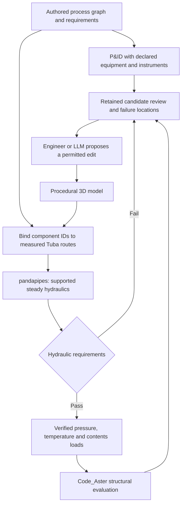

# Process model review: pandapipes, routing and Code_Aster

**Updated:** 2026-10-12. **Direction:** pandapipes is the default hydraulic
runtime. This is the active vision and review roadmap; the
[qualification record](process-network-coupling-results.md#pandapipes-default-backend-qualification)
separately records completed numerical and structural checks.

## Vision

Let an engineer define a small process network, see its instrumented P&ID and
physical pipe route together, evaluate flow constraints with pandapipes, and
inspect the resulting Code_Aster stresses, displacements and support loads.
Each candidate keeps its inputs, actual solver evidence and rejection reasons.
An LLM can propose the next route or bore change through the same authored
inputs and evaluation tools used by a person.

The shared process graph owns component and port identities, connections,
operating requirements and optional explicit P&ID declarations. Procedural
Python owns the physical model. The diagram shows connectivity; actual 3D geometry supplies bore, length, elevation and
fitting data. Neither drawing coordinates nor an LLM's estimate become measured
pipe dimensions.

The structural product contract remains Tuba model -> real Code_Aster solve ->
processed structural results. Hydraulic success alone does not establish
structural acceptance or piping-code compliance. A rejected hydraulic candidate
retains its measured fluid results and explicitly unevaluated structural checks.

## Existing foundation

| Boundary | Current role |
| --- | --- |
| `tuba/process/network.py` | Typed components, ports, connections, scenarios, requirements and associations to measured routes and elements. |
| `tuba/process/pid.py` | Explicit equipment annotations, instrument taps and validated electrical control-signal declarations; independent of numerical equipment/control behavior. |
| `tuba/process/pandapipes.py` | In-process Python hydraulic execution, retained native network/results, dependency identities and convergence diagnostics. |
| `HydraulicResults.verify_for` | Matches solve-issued evidence, unchanged artifacts and raw measurements to the current bound candidate. |
| `tuba/process/structural.py` | Explicit pressure-reference conversion, filled-bore contents density and caller-declared wall-temperature approximation. |
| Coupled evaluator and existing search archive | Bounded proposals, hydraulic gating, real Code_Aster execution and retained rejected attempts. |
| Existing review scene and viewer | Hydraulic fields with actual solver provenance; stress, displacement and reaction fields backed by completed Code_Aster artifacts. |

The [process guide](../content/process-networks.md) describes the qualified
serial-water subset and the optional `process` Python dependency. Users need no
OpenModelica installation for that workflow. Broader pandapipes capabilities
are not automatically qualified Tuba capabilities.

The DEXPI XML 2.0.1 importer supplies one selected pipe connection and its source
IDs. Its operating conditions, physical route and hydraulic assumptions remain
explicit study inputs; the imported equipment names do not imply simulated
pump or heat-exchanger behavior.

## Implemented drawing milestone

A tagged SVG process schematic is generated directly from the existing typed
graph inside the current web review. It shows the source, routed pipe, declared
fixed loss and sink in connection order, preserving stable IDs and associations
with the candidate's hydraulic segments and 3D elements.

Selecting a pipe highlights its associated route and exposes measured flow,
absolute pressure and velocity, with route and loss-coefficient details. A
source, sink or external loss clears the mechanical selection and identifies
its nonstructural scope. Hydraulic rejection remains reviewable. The
[schematic qualification](process-network-coupling-results.md#tagged-process-schematic-review)
records the fresh two-candidate solve and browser acceptance checks.

An SVG download supports sharing and vector editing. The authored Python graph
remains the editable engineering source. This is a one-way projection: changing
the downloaded drawing does not update topology, geometry, solver inputs or
existing evidence. Layout coordinates are presentation data only.

## Instrumented P&ID extension

The current extension adds an optional `PidDefinition` to the same process
graph. The authored water example explicitly declares two tanks, one control
valve, pressure and flow transmitter taps, and a flow indicating controller.
Solid process lines and taps, instrument bubbles, a panel controller and dashed
electrical signals have a drawing legend. **Open P&ID** provides a full-size
view; the same drawing is available as editable SVG.

Transmitter selection resolves an exact declared process port and displays its
calculated absolute pressure or mass flow. Equipment selection resolves its
graph component and any actual mechanical association. A controller has no
numerical output: the declared signal path does not simulate a feedback loop.
The source still prescribes 10 kg/s, and the external valve still uses the
illustrative fixed `K=5` operating point. No tank levels, valve curve, actuator
response or equipment body is added to the numerical model by its symbol.

Tags, tap ports, compatible transmitter/controller quantities and signal
directions validate before execution. Definitions round-trip with the graph
and participate in its bound fingerprint. Old graphs with no declaration keep
their previous representation; imported graphs do not receive invented tags.
The [implementation plan](process-pid-implementation-plan.md) records the
completed scope. The [instrumented P&ID qualification](process-network-coupling-results.md#instrumented-pid-review)
records fresh pandapipes/Code_Aster cases and browser checks for exact-port
values, selection, keyboard operation, candidate reset and SVG download. Legacy
drawings remain readable; invalid P&ID declarations fail explicitly.

This is an instrumented P&ID subset with documented symbols, not a claim of
standards compliance or complete plant design. Dynamic controls, valve sizing,
a browser graphical editor, graphic-to-model round-trip and DEXPI export remain
outside this milestone. The [process guide](../content/process-networks.md)
shows the authored Python declaration and exact scope.

## Linked evidence and inspection

The existing review should make these facts inspectable without installing a
solver on the viewing machine:

- Component/port IDs and connections, including imported source identity.
- Scenario, pressure references, medium assumptions and requirements.
- Actual bore, length, elevation, roughness and declared local losses.
- Measured fluid values and localized failures for the selected candidate.
- The load mapping and any completed Code_Aster results for that same revision.

Derive views from typed records and retained associations. Do not parse labels
to reconstruct engineering meaning or maintain another editable network in the
viewer. A drawing or table is not a second solver and must not manufacture
missing evidence.

| Observation | What it establishes |
| --- | --- |
| Graph and associations validate | The supported connections and route mapping are structurally consistent; this is not a hydraulic solve. |
| Pandapipes execution and declared checks pass | Evidence for the recorded hydraulic circuit, assumptions and scenario. |
| Code_Aster evaluation completes | Structural evidence for the recorded geometry and mapped operating loads. |
| Engineering review | An assessment of the stated scope and unresolved assumptions, not automatic certification. |

Changing route, bore, topology, losses, scenario, fluid properties or relevant
solver dependencies requires new evaluation. Earlier results remain attached
to the earlier candidate. Runtime failure is unresolved, and unavailable
structural evidence must stay unavailable when selecting or comparing diagrams.

## Roadmap and acceptance

| Order | Work package | Completion evidence |
| --- | --- | --- |
| 1: Implemented | Tagged SVG schematic and linked selection in the existing review | Fresh hydraulic rejection and accepted Code_Aster layout verified in the browser: nine pipe elements select together; boundary/loss selection clears them; failure labels, keyboard selection, scene-change reset and actual SVG download pass. |
| 2: Implemented | Explicit instruments and control connections | Fresh hydraulic rejection and accepted Code_Aster case, strict declarations, exact-port values, linked selection, full-size/SVG output and legacy fallback passed [qualification](process-network-coupling-results.md#instrumented-pid-review). |
| 3 | Richer assumption and candidate comparison | Offset/bore edits show changed hydraulic geometry, losses and mapped mechanical loads while preserving earlier candidates and their measured failures. |
| 4 | Qualified equipment and broader circuits | Sourced valve/pump data and each new topology have boundary-condition, conservation and independent reference checks before expanding the supported scope. |
| 5 | P&ID exchange and agent iteration | A declared DEXPI export profile preserves supported identities; pinned-provider LLM trials compare permitted edits using the same solver checks, retained history and costs. |

The completed drawing walkthrough uses a fresh smaller-bore hydraulic rejection
and a larger-bore accepted layout evaluated by pandapipes and Code_Aster. The
earlier three-candidate qualification separately retains both structural layouts,
including the displacement rejection. Focused tests cover diagram connectivity,
tag escaping, selection, unavailable results and SVG output. Use retained
qualified artifacts when checking display-only
changes; fresh solver qualification is necessary when numerical execution or
load mapping changes. Record the actual validation scope with each delivery.

Reuse `tuba/visualization` + `viewer/`, the process adapter, archive and coupled
evaluator. No new diagram package is needed for the supported serial graph.
The broader [process roadmap](process-network-and-code-aster-roadmap.md) defines
hydraulic scope and engineering qualification boundaries.

## Optional advanced simulation

The existing OpenModelica comparison backend remains available. Modelica source
inspection, OMEdit reproduction, arbitrary user packages, FMI/FMUs and transient
controls are optional advanced work, not the architecture or installation path
for this vision. Introduce them only for a concrete problem beyond the qualified
pandapipes subset, with a separate model and coupling qualification.

The earlier Modelica-centered review proposal is retained in repository history
at `da66a1f`; its completed solver evidence remains unchanged in the qualification
record. This roadmap does not relabel that historical evidence as pandapipes.
