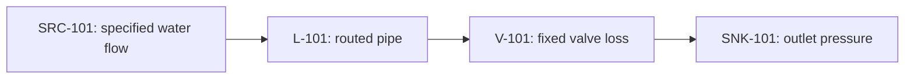
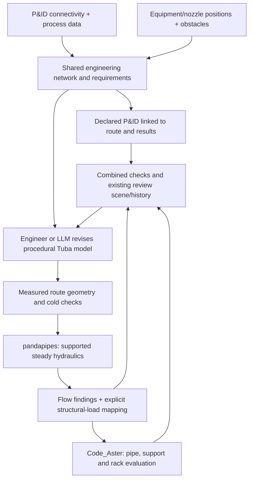

# Process networks, pandapipes, routing and Code_Aster

Updated: 2026-10-12. Active direction: pandapipes for steady hydraulics,
Code_Aster for structural evaluation, and one retained process/route review.
The original architecture was inspected at `8468090`; historical starter
evidence is preserved at the end of this document.
This extends the [LLM design roadmap](llm-piping-design-roadmap.md) and
[reasoning/guidance research](llm-piping-reasoning-and-guidance-research-2026-10-12.md).
It defines the production architecture and implementation sequence. The bounded
serial-water implementation now defaults to pandapipes, maps verified operating
loads into Code_Aster, and retains combined candidate reviews. See the
[implementation guide](../content/process-networks.md) and
[qualification results](process-network-coupling-results.md). A narrow DEXPI XML
2.0.1 adapter now imports a selected single-pipe connection from the official
reference P&ID, preserving source IDs and explicit study boundaries. Broader
DEXPI coverage, branched circuits, equipment libraries and FMUs remain future work.
OpenModelica remains an optional comparison/integration backend. Users of the
default hydraulic workflow need the `process` Python extra, not a Modelica
compiler installation.

## Start with one authored circuit

The user has no existing P&ID, so the first example defines the process
connections directly. Keep stable component and port identities in a small
network record. Later, a DEXPI importer supplies those same records. A P&ID
drawing is a view of the connections; it is not the hydraulic equation model
or the physical layout.



The [coupled example](../../examples/process_network/model.py) authors a Tuba
offset route, measures its bore and actual centerline length including arcs,
and evaluates them with the bundled Python hydraulic dependency. It prescribes
10 kg/s of water and 3 bar absolute at the outlet, then
solves for required inlet pressure. The 3 m/s maximum and 6 bar absolute
source-pressure ceiling are example requirements. Constant fluid properties,
four illustrative bend loss coefficients of 0.2, and a fixed loss coefficient
of 5 are declared assumptions. Explicit P&ID annotations identify the source
and sink as tanks and that restriction as `FCV-101`, with a pressure tap, flow
tap and declared flow-control signal path. These do not add tank or controller
dynamics or a valve characteristic. The restriction sits outside the mechanical
outlet anchor; its equipment loads are outside the structural study.

The bounded first milestone is implemented: verified pressure, temperature and
contents density feed a real Code_Aster solve, with processed results in the
existing review scene. A longer offset refreshes hydraulic loss, and a larger
bore refreshes both hydraulic area and the structural section. Three retained
layouts demonstrate a hydraulic rejection, a passing layout and a structural
rejection. The older [fluid-only starter](../../examples/process_network_starter.py)
remains a diagnostic experiment, incomplete for engineering evaluation.

## Recommended direction

Develop Tuba into the Python coordinator for a shared engineering network with
separate process, geometry, and structural projections. Keep authored procedural
Python and construction units as the editable physical design. Use pandapipes
for the supported steady hydraulics and real Code_Aster for structural
evaluation, then combine their findings for the design agent and review scene.

The design is an iteration loop, not a one-time translation from P&ID to flow
results to geometry. Preliminary hydraulics can guide diameter selection using
estimated lengths. Every actual route changes the hydraulic inputs: length,
elevation, bends, branches, valves, or bore. Reevaluate those inputs before
accepting the design. A flexibility loop can improve thermal reactions while
increasing pressure loss; a larger bore can improve a velocity check while
changing mass, stiffness, clearances, and cost.



The arrows describe sequential design evaluation. They do not imply a
time-synchronized fluid-structure co-simulation. A hydraulic rejection may skip
the expensive structural evaluation; retain the candidate and label the missing
structural results as not evaluated.

Three different uses of dimensions must stay distinct:

- A **1D fluid network** solves flow along components and connections.
- A pipe **routed in 3D space** can use Code_Aster line/pipe elements for its
  structural response. A full solid mesh of the entire plant is not required.
- **Local 3D structural analysis** can refine a selected tee, nozzle, or other
  region. This is separate from fluid simulation; see the existing
  [mixed structural coupling research](mixed-1d-3d-code-aster-coupling-research.md).

Code_Aster evaluates a proposed mechanical model. The design agent and geometry
tools generate the pipe route.

## What exists in Tuba, and what is missing

The existing structural/search seams are reused by the bounded implementation.
Its runtime qualification is recorded separately in the linked results document.

| Existing seam | Reuse for this direction |
| --- | --- |
| [Model and operations](../../tuba/model.py): pipe sections, route/element references, `Operation`, `LoadCase`, and `OperationField` | Reuse section dimensions and operating cases. Add a separate process-network contract rather than expanding the structural model into an equipment/process simulator. |
| [Semantic attributes](../../tuba/attributes.py) and [entity references](../../tuba/refs.py) | Link physical units/elements to stable process line and component identities. Existing generic attributes alone do not enforce fluid-port connectivity or hydraulic requirements. |
| [Route plans](../../tuba/routing/plan.py) and [physical quantities](../../tuba/physical.py) | Derive actual straight and bend-arc lengths, bore, and physical contents mass. Add fitting identities, roughness, and hydraulic association records. |
| [Structural load compilation](../../tuba/solver/aster_loads.py) | Pressure/temperature fields already have selectors; node temperatures have an interpolation path. Audit the supported mapping and discretization instead of inventing a second load writer. |
| [Fluid-contents example](../../examples/fluid_contents.py) | Density already contributes filled-bore weight independently of pressure. This is not a flow calculation. |
| [Search checks/history](../../tuba/search/contracts.py) and [candidate evaluation](../../tuba/search/evaluate.py) | The preparation stage now retains fluid evidence/checks and gates Code_Aster while preserving failure and unknown semantics. |
| [Review scenes](../../tuba/visualization/scene.py) and `viewer/` | The same review surface now carries fluid fields and combined findings, keeping structural values backed by matching Code_Aster evidence. |
| [Process package](../../tuba/process/) and [coupled example](../../examples/process_network/run.py) | Strict serial graph, measured route associations, pandapipes or optional OpenModelica execution, verified operating-load mapping, bounded proposals and combined reviews. |

General P&ID import, branches, equipment models and transient coupling remain
outside this implementation. The current adapter supports one declared DEXPI
2.0.1 pipe-only segment profile; its raw P&ID and import assumptions travel with
the native candidate evidence and detached review.

## Shared network and association contract

Use a small typed process graph as the shared engineering contract. The P&ID,
hydraulic model, and mechanical model are different views with explicit
associations; they should not independently invent names, connectivity, or
operating assumptions. The following describes the broader target; the current
API implements its serial-water subset:

| Record | Required meaning |
| --- | --- |
| Equipment and ports | Stable equipment/nozzle IDs, connected medium, component type, physical placement where known, and sourced equipment characteristics. Distinguish a fluid port from a structural attachment or FE node. |
| Process connections/components | Line/segment/component IDs, connectivity, section/catalogue reference, supported fluid-component type, valve/fitting data and roughness. Include explicit direction conventions while allowing physical flow reversal. |
| Operating scenarios | Medium/property package, source/sink conditions or pump curves, valve states, ambient/external pressure, and task requirements. Boundaries must yield a well-posed problem; do not independently prescribe arbitrary pressures and flows everywhere. |
| Physical associations | Process component/segment -> Tuba route/unit -> station interval/elements. A line may span many hydraulic components and many FE elements. Shoe-induced FE subdivisions are not additional process junctions. |
| Evaluation evidence | Candidate and geometry hashes, operating scenario, source/requirement versions, solver/library/model versions, result artifacts, convergence status, and association-map identity. |

Extract hydraulic geometry from the built candidate, not just its declared
parameters. Include the physical bore (`OD - 2*WT` for the applicable section),
true centerline arc lengths, endpoint elevations, bends, reducers, tees and
valves. Define how distributed friction and local fitting losses are partitioned
so a fitting is neither omitted nor counted twice. Rebuild associations after
topology edits. A pressure or velocity from an older route must become stale.

A machine-readable P&ID can supply tags, topology, and some attributes. It does
not by itself supply a complete simulation problem or physical plant layout.
Missing nozzle positions, equipment curves, fluid properties, loss data, and
operating conditions must remain explicit missing inputs.

For exchange, use versioned DEXPI adapters around the internal contract. The
official specification now recommends **DEXPI 2.0.1**; the inspected pyDEXPI
README explicitly advertises **1.3** support and a NetworkX graph representation.
Do not infer compatibility between those versions. Start with a small Python
authored network and one declared import subset; accept image/PDF extraction
later as a proposed graph with unresolved/uncertain links. Sources:
[DEXPI specifications](https://dexpi.org/specifications/),
[pyDEXPI implementation](https://github.com/process-intelligence-research/pyDEXPI).

## Default Python hydraulic execution

The selected runtime is pandapipes 0.15.0. It evaluates the existing bound
serial-water graph in Python without an external compiler. Preserve actual
solver provenance throughout the recorded checks, structural-load mapping,
review and iteration film. Never label pandapipes output as OpenModelica.

The first qualified scope uses constant-property water and Prandtl-Colebrook
friction at pipe Reynolds numbers >= 4,000. Unit conversion, absolute versus
gauge pressure, junction elevation and declared local losses require explicit
verification. A package's broader capabilities do not automatically expand
Tuba's supported graph or qualify its component data. Retain OpenModelica as an
optional independent comparison and future advanced-system integration.
Sources: [pandapipes](https://www.pandapipes.org/),
[pipe equations and friction models](https://pandapipes.readthedocs.io/en/latest/components/pipe/pipe_component.html).

## Generate the P&ID from the same graph

The implemented drawing milestone projects the existing typed graph into a tagged
SVG inside the existing review. It shows the source, pipe, external fixed loss
and sink, their ports and connections. Selecting a component identifies its
actual route/elements and measured hydraulic values; nonstructural components
remain explicit. This also applies to a candidate rejected before Code_Aster.
The [review vision](process-model-review-study.md) defines the detailed scope;
the [schematic qualification](process-network-coupling-results.md#tagged-process-schematic-review)
records fresh pandapipes/Code_Aster and browser acceptance evidence.

The authored graph remains editable Python. An SVG download supports sharing
and vector editing, but graphic edits do not update the graph or simulation.
Drawing positions never determine physical dimensions. This milestone needs no
additional drawing dependency, browser graphical editor or second scene system.

The current P&ID extension adds an optional strict `PidDefinition` to the graph.
It carries declared equipment annotations, `PT`/`FT` process-port taps,
`PIC`/`FIC` controllers and compatible electrical signal links. The water
example declares `TK-101`, `TK-102`, `FCV-101`, `PT-101`, `FT-101` and `FIC-101`.
A legend explains the supported symbols, solid process/tap lines and dashed
signals. The existing viewer provides **Open P&ID** and **Download SVG**.

These declarations express design intent. Transmitter displays read calculated
values at their exact ports; a controller has no fabricated numerical output.
The equipment remains represented by the graph's existing boundary or fixed-K
approximation. The signal loop does not control a pandapipes valve or qualify a
valve curve. Tags, references, signal direction and quantity compatibility
validate before evaluation. Old graphs preserve their representation and
imported graphs receive no invented tags.

See the [implementation plan](process-pid-implementation-plan.md) for the
completed instrumented subset and its acceptance checks. The
[instrumented P&ID qualification](process-network-coupling-results.md#instrumented-pid-review)
records fresh pandapipes/Code_Aster evidence, exact-port values, browser
selection/reset/keyboard/download checks and legacy fallback. General plant
drawings, standards-compliance claims, dynamic controls and graphical authoring are
outside its scope. An LLM can propose structured declarations and identify
missing inputs; validation and engineering review still apply.

DEXPI export is separate future work requiring a declared supported version and
round-trip checks. The existing 2.0.1 importer does not establish export support.
For broader drawing/exchange tooling, evaluate
[pyDEXPI](https://github.com/process-intelligence-research/pyDEXPI) against that
version contract. [pyflowsheet](https://github.com/nukleon84/pyflowsheet) targets
process-flow diagrams and does not replace P&ID CAD. Neither package is needed
for this serial P&ID subset.

## Flow constraints and structural loads

Represent `maximum_velocity = 3 m/s` as a scenario/line requirement, with
scope, units, source, and allowed design changes. It is the user's example
limit, not a universal piping standard. Also express minimum delivered flow,
minimum outlet pressure, allowable losses, and applicable equipment constraints.
A low-flow candidate must not pass simply because its velocity is small.

An illustrative constant-flow calculation: at 10 L/s, a 50 mm bore gives
5.09 m/s and an 80 mm bore gives 1.99 m/s. The 3 m/s limit requires at least
65.15 mm of bore under those assumptions. These are `v = Q/A` calculations,
not simulated pandapipes or Code_Aster results, and not catalogue-size selections.
The network solve determines actual flows when pump/valve characteristics and
pressure boundaries are involved.

| Fluid/equipment output | Proposed mechanical input and explicit boundary |
| --- | --- |
| Absolute fluid pressure and known external pressure | Map the declared pressure differential to the applicable Tuba pressure load. Do not feed absolute pressure into a gauge/differential interpretation unchanged; preserve spatial variation and reference conventions. |
| Evaluated fluid density | Use contents mass with the declared fill state and gravity. The existing density field describes a completely filled bore; partial filling/two-phase inventories need a new supported model. |
| Fluid state and a declared wall thermal model | Apply **wall** temperature relative to the mechanical reference temperature. Uniform wall temperature equal to bulk fluid temperature is an explicit approximation; wall inertia, insulation, or gradients require appropriate thermal modeling. Convert kelvin to Tuba's Celsius convention explicitly. |
| Flow/momentum changes and equipment thrusts | Add only loads supported by the selected formulation. Check pressure/end effects and equilibrium before adding bend/nozzle forces; avoid counting a pressure contribution twice. This requires dedicated verification beyond a pressure/temperature transfer. |

Pandapipes pressure conventions require explicit conversion: the adapter
converts between Tuba absolute Pa and solver gauge bar using the atmospheric
reference at each junction elevation. The current temperature is prescribed
uniformly, not obtained from a heat-transport solve. The constant-property water
assumptions and supported Reynolds range remain visible in each study.

An operating fluid solve does not replace independent design, shutdown,
hydrotest, or other required mechanical cases. Passing the declared constraints
also does not imply complete piping-code qualification. Keep applicable
project/code assessment explicit and tied to its inputs and evidence.

## Development sequence

| Stage | Deliverable | Completion evidence |
| --- | --- | --- |
| P0: Shared graph and measured associations | Typed components, ports, scenarios and requirements bound to authored Tuba routes | Implemented for a serial water circuit; route edits preserve process identities and invalidate previous hydraulic evidence. |
| P1: Pandapipes steady hydraulics | Python execution with retained native inputs/results and dependency identity | Qualified bounded cases check mass balance, friction/local losses, elevation, absolute/gauge pressure conversion and failure handling; check delivery as well as velocity. |
| P2: Code_Aster operating evaluation | Verified pressure, temperature and contents mapping through existing operations | Real cantilever references and the three-layout campaign verify the supported mapping and retain all structural fields and failures. |
| P3: Linked schematic and existing review | Implemented tagged SVG, component-to-route selection, actual hydraulic values and SVG download | Browser checks pass on fresh rejected/accepted layouts: pipe and nonstructural selection, measured failure display, keyboard operation, scene reset and actual SVG download; topology and SVG content have focused tests. |
| P4a: Instrumented P&ID (implemented) | Explicit equipment, transmitter taps, controller/signal declarations and full-size/SVG review | Strict declarations, exact-port values and browser checks pass with a fresh small-bore rejection and accepted Code_Aster case; see the [qualification record](process-network-coupling-results.md#instrumented-pid-review). |
| P4b: Qualified equipment and broader hydraulics | Sourced valve/pump data and supported branches | Validate each added graph type, equipment correlation and boundary specification against reference cases. Qualify DEXPI export separately. |
| P5: Controlled agent evaluation | Pinned-provider LLM proposals through existing bounded inputs and solver loop | Preserve every candidate, requirement and measured failure; compare proposal policies under recorded model versions, costs and engineering outcomes. |

P0 and the bounded P1/P2 scope are implemented. See the
[pandapipes qualification](process-network-coupling-results.md#pandapipes-default-backend-qualification)
for actual values, tolerances, runtimes and retained evidence. The current
proposal input and iteration film already provide groundwork for P5; a
controlled provider benchmark remains open. The fixed loss and bend coefficients
are illustrative assumptions, so equipment catalogue qualification remains open.

P3's first linked schematic is implemented and verified in the existing review.
Its fresh walkthrough covers the smaller-bore hydraulic rejection and accepted
larger-bore Code_Aster layout. The earlier three-candidate hydraulic/structural
qualification remains separate and retains both FE layouts. Richer assumption
inspection and candidate comparison remain next. P4a now adds declared
instrument/control drawing semantics with its own acceptance checks; equipment
behavior and broader circuits require separate numerical qualification.

The existing P4 import subset accepts one selected single-pipe/nozzle-boundary
connection from the pinned official DEXPI 2.0.1 fixture. Source equipment names
and IDs are preserved, but the example supplies its own water scenario and
physical route. It does not simulate the full reference plant.

The decisive edit check remains: lengthen the offset and verify changed measured
hydraulic length and losses while connectivity stays fixed; change bore and
verify both fluid area and physical section change. A topology edit requires
new associations. Existing numerical evidence cannot become current merely by
redrawing the diagram.

Keep the implementation within `tuba/process/`, existing operation/load writers,
search evidence and `tuba/visualization` + `viewer/`. No FMU, compiler service or
synchronized co-simulation is required to run pandapipes and pass verified loads
to Code_Aster.

### Run the current workflow

Install Tuba's optional `process` dependency and configure the existing
Code_Aster runtime. The default command needs no hydraulic compiler:

```powershell
python -m pip install '.[process]'
python -m examples.process_network.run `
  --output 'D:\tuba-runs\Tuba_v4\my-process-study'
```

Use a fresh directory outside the checkout. The
[process guide](../content/process-networks.md) describes runtime setup, review,
DEXPI import and bounded proposal input. A detached review can inspect retained
results without either solver installed; new structural evidence always needs
real Code_Aster execution.

## Optional advanced-system integration

The existing OpenModelica backend remains an optional comparison path selected
with `--backend openmodelica`. It has its own compiler/library provenance and
qualification scope. Preserve historical results under their actual solver
identity. Modelica source inspection and OMEdit reproduction are optional expert
features, not the first review milestone.

For a future task involving startup controls, coupled thermal dynamics or a
portable subsystem, assess a suitable Modelica model or FMI/FMU interface.
OMPython interfaces with OpenModelica; FMPy executes an already built FMU. Neither
supplies missing Tuba component data or the fluid-to-structure coupling contract.
Qualify the chosen model, events, time/discretization convergence and coupling
method before making new engineering claims. Sources:
[OMPython](https://openmodelica.org/doc/OpenModelicaUsersGuide/latest/ompython.html),
[FMPy](https://github.com/CATIA-Systems/FMPy),
[FMI specification](https://fmi-standard.org/docs/3.0.2/).

## Historical OpenModelica starter and research

The following records the original fluid-only starter and adapter choices as of
2026-10-12, before pandapipes became the default. It is retained engineering and
research history, not the current development sequence or required installation
path. The coupled workflow above supersedes it for the supported serial circuit.

### Running the historical fluid-only starter


From a checkout with Tuba dependencies available, choose a **new** output
directory outside the checkout. For the installed Windows compiler:

```powershell
.\.venv\Scripts\python.exe -m examples.process_network_starter `
  --omc 'C:\Program Files\OpenModelica1.27.0-dev-64bit\bin\omc.exe' `
  --output 'D:\tuba-runs\Tuba_v4\my-water-starter-run'
```

The example pins Modelica Standard Library 4.1.0. The compiler path is a local
installation detail, not a required version or global PATH modification.
`--outside-diameter`, `--wall-thickness`, and `--offset` select geometric
variants in metres. Outputs contain the network, Tuba model, generated Modelica
and compiler script, compiler log, raw hydraulic CSV, candidate/source/result
hashes, and processed hydraulic checks. An existing output directory is refused
so an old CSV cannot be reused as a new successful solve.

Portable tests in [test_process_network_starter.py](../../tests/test_process_network_starter.py)
exercise fixed nozzle positions through offset edits, arc lengths, bore changes,
stable process connectivity, changed candidate identity, unavailable runtime,
stale output rejection, and invalid/conservation-breaking result data. Their
synthetic CSV fixtures are parser tests, not engineering evidence.

Local real-run validation on 2026-10-12 used OpenModelica
`v1.27.0-dev-574-g5a19131b33` and Modelica 4.1.0. Each row below is a newly
compiled and executed hydraulic case, using the same 10 kg/s demand and
declared loss assumptions:

| Case | Measured bore | Measured route length | Calculated velocity | Calculated pressure drop | 3 m/s check |
| --- | --- | --- | --- | --- | --- |
| Small bore, 1 m offset | 52.48 mm | 9.885 m | 4.643 m/s | 1.03286 bar | Fail |
| Larger bore, 1 m offset | 77.92 mm | 9.885 m | 2.106 m/s | 0.18305 bar | Pass |
| Larger bore, 3 m offset | 77.92 mm | 13.885 m | 2.106 m/s | 0.20529 bar | Pass |

All three simulations reached their requested endpoint and passed the
boundary/mass-conservation checks. A separate Darcy-Weisbach/Colebrook
calculation, using the reported fluid properties and declared local losses,
agreed with the total pressure drops within 0.008%. This is a limited
single-circuit reference check; it does not qualify broader hydraulic regimes
or mechanical results. The structural and overall engineering acceptance
statuses remain `not_evaluated` in every result record.

Raw models, scripts, logs, CSVs, results, and the comparison manifest are
retained locally under
`D:/tuba-runs/Tuba_v4/process-network-starter-20261012/`.
The [portable contract tests](../../tests/test_process_network_starter.py)
passed 17 cases. No installation, DEXPI import, FMU execution, Code_Aster study,
or combined result visualization was performed for this starter.

### Historical adapter choices (2026-10-12)

Since there is no existing P&ID, start with a small authored water circuit and
derive its schematic from the shared network. P&ID import is a later adapter;
it is not a prerequisite for the first working example.

**First fluid template.** Use an explicit `inner Modelica.Fluid.System`,
`MassFlowSource_T`, a `StaticPipe`, and an outlet `Boundary_pT`, all redeclaring
the same Medium. Prescribe inlet mass flow and temperature plus outlet absolute
pressure; let the model calculate the required inlet pressure. This tests pipe
sizing at a specified delivery, not whether a particular pump can supply it.
`ConstantPropertyLiquidWater` is a simple incompressible medium with fixed
density/viscosity; record that approximation. Source temperatures describe
incoming fluid, not a wall thermal calculation. Sources:
[fluid boundaries](https://doc.modelica.org/Modelica%204.1.0/Resources/helpDymola/Modelica_Fluid_Sources.html),
[constant-property water](https://build.openmodelica.org/Documentation/Modelica.Media.Water.ConstantPropertyLiquidWater.html).

Feed measured route length, bore, roughness, and elevation difference into the
pipe. `StaticPipe` has steady balances without mass/energy storage, including
friction and gravity. Its straight-pipe model does not supply bend or valve
losses merely because Tuba geometry contains those objects. Add documented
local-loss components and data explicitly. The starter uses
`SimpleGenericOrifice` components with declared illustrative loss coefficients
for the bends and fixed valve, restricted to forward flow; catalogue data and
component-specific validation remain production work. Connecting several
static components can require a nonlinear solve. Sources:
[fixed local-loss component](https://build.openmodelica.org/Documentation/Modelica.Fluid.Fittings.SimpleGenericOrifice.html),
[MSL pipe models](https://doc.modelica.org/Modelica%204.1.0/Resources/helpDymola/Modelica_Fluid_Pipes.html).

**Smallest Python bridge.** Python can invoke an explicitly resolved `omc.exe`
with a generated `.mos` script using `subprocess`, a timeout, and a task-owned
working directory outside tracked source. The official compiler supports this
script mode. Load the pinned Modelica library and generated `.mo` model, check
it, then call `simulate(..., outputFormat="csv")`. `simulate` translates,
builds, and executes; a successful `loadFile` or `checkModel` is insufficient.
Preserve compiler/simulation diagnostics and reject missing or invalid result
artifacts. Sources:
[compiler CLI scripting](https://openmodelica.org/doc/OpenModelicaUsersGuide/1.26/introduction.html#running-the-compiler-from-command-line),
[simulation API](https://build.openmodelica.org/Documentation/OpenModelica.Scripting.simulate.html).

Expose named output aliases for each supported process ID, then read CSV with
Python's standard `csv` module. Verify required columns, finite values,
conservation, and scenario requirements; preserve raw output alongside typed
results. CSV is supported for external processing, while OpenModelica's
`val()`/`plot()` require other result formats. Source:
[result formats](https://openmodelica.org/doc/OpenModelicaUsersGuide/1.26/introduction.html#alternative-simulation-output-formats).
OMPython remains an optional next bridge. Pin its API: the 1.27 guide uses
`OMCSessionZMQ`; the latest guide introduces `OMCSessionLocal` and
`ModelicaSystemOMC` with compatibility aliases. Sources:
[1.27 Python interface](https://openmodelica.org/doc/openmodelica-doc_1.27.0/OpenModelicaUsersGuide/ompython.html),
[current Python interface](https://openmodelica.org/doc/OpenModelicaUsersGuide/latest/ompython.html).

**P&ID import versions.** DEXPI recommends 2.0.1; version 2.0 introduced DEXPI XML,
distinct from earlier Proteus serialization. pyDEXPI advertises 1.3 support:
`ProteusSerializer().load(directory_path, filename)` imports that format and
`GraphLoader().parse_dexpi_to_graph(...)` yields a full `MultiDiGraph`.
This requires a matching machine-readable export or reference fixture, not an
arbitrary image/PDF. Map its full model to the supported process contract;
review abstractions before discarding valves, fittings, or port identities.
The implemented 2.0.1 adapter is separate from pyDEXPI and keeps layout and
operating data as explicit caller inputs. Its supported profile is documented
in the [process-network guide](../content/process-networks.md). Sources:
[DEXPI formats/versions](https://dexpi.org/specifications/),
[pyDEXPI importer/graph APIs](https://github.com/process-intelligence-research/pyDEXPI).
