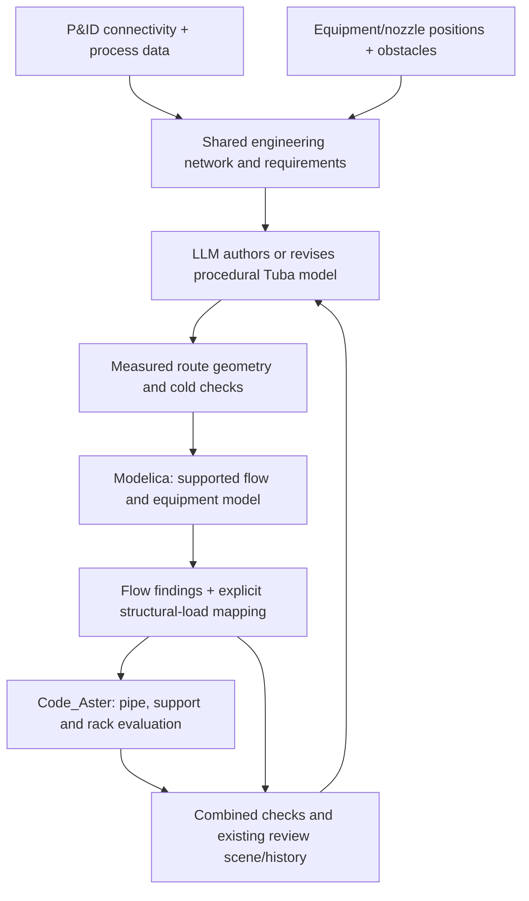

# P&ID, flow simulation, routing, and Code_Aster

Research/design date: 2026-10-12. Repository inspected at `8468090`.
This extends the [LLM design roadmap](llm-piping-design-roadmap.md) and
[reasoning/guidance research](llm-piping-reasoning-and-guidance-research-2026-10-12.md).
It proposes an architecture and implementation sequence. No Modelica model,
FMU, hydraulic trial, or fresh Code_Aster study was executed for this note.

## Recommended direction

Develop Tuba into the Python coordinator for a shared engineering network with
separate process, geometry, and structural projections. Keep authored procedural
Python and construction units as the editable physical design. Use Modelica for
the supported fluid/equipment equations and real Code_Aster for structural
evaluation, then combine their findings for the design agent and review scene.

The design is an iteration loop, not a one-time translation from P&ID to flow
results to geometry. Preliminary hydraulics can guide diameter selection using
estimated lengths. Every actual route changes the hydraulic inputs: length,
elevation, bends, branches, valves, or bore. Reevaluate those inputs before
accepting the design. A flexibility loop can improve thermal reactions while
increasing pressure loss; a larger bore can improve a velocity check while
changing mass, stiffness, clearances, and cost.

The arrows describe sequential design evaluation. They do not imply a
time-synchronized fluid-structure co-simulation. A hydraulic rejection may skip
the expensive structural evaluation; retain the candidate and label the missing
structural results as not evaluated.

Three different uses of dimensions must stay distinct:

- A **1D fluid network** solves flow along components and connections.
- A pipe **routed in 3D space** can use Code_Aster line/pipe elements for its
  structural response. A full solid mesh of the entire plant is not required.
- **Local 3D structural analysis** can refine a selected tee, nozzle, or other
  region. This is separate from fluid simulation; see the existing
  [mixed structural coupling research](mixed-1d-3d-code-aster-coupling-research.md).

Code_Aster evaluates a proposed mechanical model. The design agent and geometry
tools generate the pipe route.

## What exists in Tuba, and what is missing

These are source-inspection findings, not newly qualified runtime capabilities.

| Existing seam | Reuse for this direction |
| --- | --- |
| [Model and operations](../../tuba/model.py): pipe sections, route/element references, `Operation`, `LoadCase`, and `OperationField` | Reuse section dimensions and operating cases. Add a separate process-network contract rather than expanding the structural model into an equipment/process simulator. |
| [Semantic attributes](../../tuba/attributes.py) and [entity references](../../tuba/refs.py) | Link physical units/elements to stable process line and component identities. Existing generic attributes alone do not enforce fluid-port connectivity or hydraulic requirements. |
| [Route plans](../../tuba/routing/plan.py) and [physical quantities](../../tuba/physical.py) | Derive actual straight and bend-arc lengths, bore, and physical contents mass. Add fitting identities, roughness, and hydraulic association records. |
| [Structural load compilation](../../tuba/solver/aster_loads.py) | Pressure/temperature fields already have selectors; node temperatures have an interpolation path. Audit the supported mapping and discretization instead of inventing a second load writer. |
| [Fluid-contents example](../../examples/fluid_contents.py) | Density already contributes filled-bore weight independently of pressure. This is not a flow calculation. |
| [Search checks/history](../../tuba/search/contracts.py) and [candidate evaluation](../../tuba/search/evaluate.py) | Extend the evidence/check contract to fluid outcomes. Preserve current failure and unknown semantics. Explicit flow check kinds and an evaluation stage are still required. |
| [Review scenes](../../tuba/visualization/scene.py) and `viewer/` | Extend this existing review surface with fluid fields and combined findings, keeping structural values backed by matching Code_Aster evidence. |

No Modelica/DEXPI bridge or hydraulic network solver was found in the inspected
Tuba source. Geometry, operating fields, and fluid density are useful foundation
pieces, not an already implemented process simulation workflow.

## Shared network and association contract

Use a small typed process graph as the shared engineering contract. The P&ID,
hydraulic model, and mechanical model are different views with explicit
associations; they should not independently invent names, connectivity, or
operating assumptions. Proposed records, not existing APIs:

| Record | Required meaning |
| --- | --- |
| Equipment and ports | Stable equipment/nozzle IDs, connected medium, component type, physical placement where known, and sourced equipment characteristics. Distinguish a fluid port from a structural attachment or FE node. |
| Process connections/components | Line/segment/component IDs, connectivity, section/catalogue reference, supported fluid-component type, valve/fitting data and roughness. Include explicit direction conventions while allowing physical flow reversal. |
| Operating scenarios | Medium/property package, source/sink conditions or pump curves, valve states, ambient/external pressure, and task requirements. Boundaries must yield a well-posed problem; do not independently prescribe arbitrary pressures and flows everywhere. |
| Physical associations | Process component/segment -> Tuba route/unit -> station interval/elements. A line may span many hydraulic components and many FE elements. Shoe-induced FE subdivisions are not additional process junctions. |
| Evaluation evidence | Candidate and geometry hashes, operating scenario, source/requirement versions, solver/library/model versions, result artifacts, convergence status, and association-map identity. |

Extract hydraulic geometry from the built candidate, not just its declared
parameters. Include the physical bore (`OD - 2*WT` for the applicable section),
true centerline arc lengths, endpoint elevations, bends, reducers, tees and
valves. Define how distributed friction and local fitting losses are partitioned
so a fitting is neither omitted nor counted twice. Rebuild associations after
topology edits. A pressure or velocity from an older route must become stale.

A machine-readable P&ID can supply tags, topology, and some attributes. It does
not by itself supply a complete simulation problem or physical plant layout.
Missing nozzle positions, equipment curves, fluid properties, loss data, and
operating conditions must remain explicit missing inputs.

For exchange, use versioned DEXPI adapters around the internal contract. The
official specification now recommends **DEXPI 2.0.1**; the inspected pyDEXPI
README explicitly advertises **1.3** support and a NetworkX graph representation.
Do not infer compatibility between those versions. Start with a small Python
authored network and one declared import subset; accept image/PDF extraction
later as a proposed graph with unresolved/uncertain links. Sources:
[DEXPI specifications](https://dexpi.org/specifications/),
[pyDEXPI implementation](https://github.com/process-intelligence-research/pyDEXPI).

## Modelica integration

Use an optional Python-managed external OpenModelica adapter. Compile a
supported network assembled from tested component templates and `connect`
relations; keep any user-authored Modelica package intact. Deterministic
translation should produce simulation inputs, leaving the LLM to choose and
revise the engineering design rather than inventing component equations.

`Modelica.Fluid.Pipes.StaticPipe` provides steady mass/momentum/energy balances
with length, inner diameter, roughness, and height difference. Fitting losses
need appropriate components/correlations; an ideal junction is not a calibrated
tee loss. Start with a supported single-phase liquid application and explicit
validity bounds. `DynamicPipe` adds distributed balances/storage, but requires
appropriate initialization and numerical settings. These components do not
automatically establish validated water-hammer, multiphase, or fluid-structure
interaction capability. Sources:
[StaticPipe](https://build.openmodelica.org/Documentation/Modelica.Fluid.Pipes.StaticPipe.html),
[DynamicPipe](https://build.openmodelica.org/Documentation/Modelica.Fluid.Pipes.DynamicPipe.html),
[fittings](https://build.openmodelica.org/Documentation/Modelica.Fluid.Fittings.html).

For each candidate/scenario:

1. Validate required data and supported components; generate the Modelica
   network plus an explicit component-to-process-ID output map.
2. Through OMPython, load/check/build and execute the real OpenModelica model.
   Preserve translation/simulation errors and failed initialization. Compiling
   a model is not a completed simulation.
3. Extract signed mass flow, pressures and thermodynamic states at defined
   ports/stations; calculate velocities and requirement findings from those
   evaluated values.
4. Check solver success and relevant conservation residuals; produce typed
   candidate/scenario results with units and artifact provenance.
5. Reuse a compiled model only for parameters that the selected model actually
   exposes as runtime-settable. Topology or structural-parameter changes require
   a new build and must invalidate the relevant evidence.

OMPython is an interface to OpenModelica compilation/simulation; its compiler
sessions require an installed compiler, while it can also run already built
executables. Pin and record the runtime, Modelica library, media, component
templates, and integration settings. Keep dependencies optional, use explicit
runtime diagnostics, and preserve build/output payloads outside tracked source.
Source: [official OMPython guide](https://openmodelica.org/doc/OpenModelicaUsersGuide/latest/ompython.html).

Use **FMI/FMU** when portable subsystem delivery or execution in another
simulation environment is useful. FMPy runs an existing FMU; it does not compile
Modelica source. Model Exchange delegates integration to the importing
environment; Co-Simulation supplies a subsystem solution method and exchanges
data at communication points. Neither format supplies the missing Tuba
fluid-to-structure mapping or coupling algorithm. A sequential Python design
loop is sufficient for the first milestone. Sources:
[FMI specification](https://fmi-standard.org/docs/3.0.2/),
[FMPy](https://github.com/CATIA-Systems/FMPy),
[OpenModelica FMI support](https://openmodelica.org/doc/OpenModelicaUsersGuide/latest/fmitlm.html).

## Flow constraints and structural loads

Represent `maximum_velocity = 3 m/s` as a scenario/line requirement, with
scope, units, source, and allowed design changes. It is the user's example
limit, not a universal piping standard. Also express minimum delivered flow,
minimum outlet pressure, allowable losses, and applicable equipment constraints.
A low-flow candidate must not pass simply because its velocity is small.

An illustrative constant-flow calculation: at 10 L/s, a 50 mm bore gives
5.09 m/s and an 80 mm bore gives 1.99 m/s. The 3 m/s limit requires at least
65.15 mm of bore under those assumptions. These are `v = Q/A` calculations,
not simulated Modelica or Code_Aster results, and not catalogue-size selections.
The network solve determines actual flows when pump/valve characteristics and
pressure boundaries are involved.

| Fluid/equipment output | Proposed mechanical input and explicit boundary |
| --- | --- |
| Absolute fluid pressure and known external pressure | Map the declared pressure differential to the applicable Tuba pressure load. Do not feed absolute pressure into a gauge/differential interpretation unchanged; preserve spatial variation and reference conventions. |
| Evaluated fluid density | Use contents mass with the declared fill state and gravity. The existing density field describes a completely filled bore; partial filling/two-phase inventories need a new supported model. |
| Fluid state and a declared wall thermal model | Apply **wall** temperature relative to the mechanical reference temperature. Uniform wall temperature equal to bulk fluid temperature is an explicit approximation; wall inertia, insulation, or gradients require appropriate thermal modeling. Convert kelvin to Tuba's Celsius convention explicitly. |
| Flow/momentum changes and equipment thrusts | Add only loads supported by the selected formulation. Check pressure/end effects and equilibrium before adding bend/nozzle forces; avoid counting a pressure contribution twice. This requires dedicated verification beyond a pressure/temperature transfer. |

Modelica fluid connectors carry absolute pressure, signed mass flow and stream
enthalpy/composition, not a simple temperature field. Expose flow-direction-aware
evaluated states through the Medium model rather than treating `h_outflow` as
temperature. The thermal interface distinguishes fluid and heat-port
temperatures. Sources:
[FluidPort](https://build.openmodelica.org/Documentation/Modelica.Fluid.Interfaces.FluidPort.html),
[official connector/state implementation](https://raw.githubusercontent.com/modelica/ModelicaStandardLibrary/v4.1.0/Modelica/Fluid/Interfaces.mo),
[heat-transfer interface](https://doc.modelica.org/Modelica%204.1.0/Resources/helpDymola/Modelica_Fluid_Interfaces.html#Modelica.Fluid.Interfaces.PartialHeatTransfer).

An operating fluid solve does not replace independent design, shutdown,
hydrotest, or other required mechanical cases. Passing the declared constraints
also does not imply complete piping-code qualification. Keep applicable
project/code assessment explicit and tied to its inputs and evidence.

## Development sequence and first task

| Stage | Deliverable | Completion evidence |
| --- | --- | --- |
| P0: Shared contract | Typed network, scenarios, requirements and route associations, kept beside the structural model; one small Python-authored liquid circuit | Reject missing/contradictory inputs; retain stable IDs through physical edits; derive bore, arc length, elevations and fittings from the built model. |
| P1: Real steady fluid evaluation | Optional OpenModelica/OMPython adapter and results contract; one explicit component subset | Run real supported circuits; verify mass balance and an independent friction/loss reference; diagnose unavailable runtime, convergence failure and unsupported components. Check velocity **and** required delivery. |
| P2: Fluid-to-structure mapping | Reuse existing operation/load compilation and run real Code_Aster | Verify absolute/differential pressure conventions, temperature conversion, contents weight and association completeness; compare reactions/stresses to appropriate references for a pressure/thermal liquid circuit. |
| P3: Combined LLM design/review loop | Candidate evaluation combines flow and structural findings; existing scene/history displays both | Preserve every proposal and measured failure; route revisions refresh hydraulic inputs; acceptance requires all declared checks and matching evidence. Compare skill/context variants under a pinned model. |
| P4: P&ID exchange and broader circuits | One explicitly supported DEXPI adapter, branches, equipment libraries and operation modes | Confirm import coverage and source-ID preservation; verify actual component correlations and boundary specifications. Image extraction remains provisional until checked. |
| P5: Dynamics and portable subsystems | FMU interface, startup/control scenarios, wall thermal dynamics; selected transient/coupling models | Verify events, discretization and time convergence. Introduce synchronized coupling only when the physical problem requires it and qualify the particular model. |

**First implementation task: P0, the network/route association contract.** Use a
source boundary, a pipe line with one editable offset, a catalogue valve, and a
sink boundary. Specify the medium, roughness/loss data, operating conditions,
required delivery, and velocity/pressure limits. Give each component/port a
stable ID and map the pipe line to authored Tuba units and station spans.

The decisive contract check is an edit: lengthen the offset and prove that the
derived hydraulic length/fitting inputs change while the P&ID connectivity
stays the same. A bore change must update both the fluid area and physical
section. A topology change must regenerate associations; hydraulic results from
the previous candidate cannot remain current. Portable contract tests are
appropriate here, but hydraulic engineering evidence begins only in P1 and
structural engineering evidence requires P2's real Code_Aster solve.

Keep the implementation small: a dedicated `tuba/process/` boundary for network
and association/results records, an optional Modelica adapter, and narrow
extensions to the existing candidate evaluator and scene contract. These are
proposed locations, not installed functionality. Reuse existing load writers,
model authoring, evidence, and visualization instead of adding parallel systems.

Research validation: current Tuba seams inspected; official primary-source
documentation checked; local document links and whitespace checked. No runtime
availability, performance, integrated solve, or coupled-design success rate is
claimed by this architecture note.
