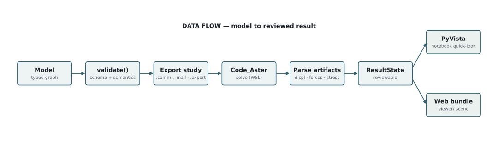

# Current architecture

Tuba v4 has one production workflow:

1. A **Tuba model** owns the authored piping and supporting structure, materials, sections, supports, loads, operations, and imported context. Procedural `model.py` is the authoring source shared by Studio, CLI and MCP.
2. The solver boundary exports a Code_Aster study and runs Code_Aster as an external process. Exported input files alone are an incomplete handoff.
3. **Artifact import** validates the study, mesh, result, and execution lineage before linking Code_Aster data into an `AnalysisRun` with persistent `ResultState` and transient `FEAResults` records.
4. Reporting builds renderer-independent engineering review records from those supplied authoritative records. It never substitutes for a solve.
5. One of the two supported visualization paths displays the model or processed results.

## Ownership boundaries

| Boundary | Current owner | Contract |
| --- | --- | --- |
| Model authoring | `tuba.model`, `tuba.builder` | Validated piping and operation records |
| Project workflow | `tuba.project`, `tuba.studio`, `tuba.mcp` | Shared authored inputs, verification gate and evidence lifecycle |
| Route proposals | `tuba.routing` | Geometric candidates; explicit application to the model |
| Retained search | `tuba.search` | Bounded candidate builds, verified Code_Aster evaluations and recorded decisions |
| Process coupling | `tuba.process` | Typed graph, route binding, hydraulic evidence, P&ID and structural load mapping |
| Study generation and execution | `tuba.solver` | Native Tuba export plus external Code_Aster execution |
| Artifact import | `tuba.analysis` | Provenance-checked parsed solver evidence |
| Engineering review | `tuba.reporting` | Tables, diagnostics, and report outputs |
| PyVista quick-look | `tuba/plotting/` | Interactive/notebook result views and PLY, glTF, or Blender export |
| Reviewable web scene | `tuba/visualization/` and `viewer/` | Portable semantic scene and browser review bundle |

The two display paths are complementary, not interchangeable implementations and not optional replacements for Code_Aster. Use one path per notebook or example. See [visualization architecture](visualization.md) for their exact responsibilities and [the workflow](../workflow.md) for an end-to-end sequence.

## Process and search workflows

[Process networks](../process-networks.md) keeps the cold mechanical model and
process graph as authored inputs. Passing current hydraulic evidence maps
loads onto a model copy before Code_Aster execution. pandapipes is the default
hydraulic backend; OpenModelica is an optional comparison. The linked P&ID
uses declared equipment, instruments and signals; control dynamics are not
part of this workflow.

[Retained piping search](../piping-search.md) records proposals, failures,
verified evaluations and decisions. Replay and film read those records and
native artifacts; generating a replay or film does not perform a fresh solve.
The initial strategy is a deterministic parameter grid. Broader optimization
and equipment/circuit qualification remain separate work.
