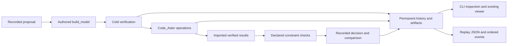

# Retained piping search

`tuba.search` connects authored model generation, cold verification, real
Code_Aster evaluation and processed-result review. It retains rejected layouts
and their reasons so the search can be reviewed and improved later. The initial
strategy is a deterministic sequential parameter grid.



## Author a search project

A project contains `model.py`, `study.py` and `search.py`.

`model.py` defines `build_model(parameters)` returning a fresh model, and binds
`model = build_model(DEFAULT_PARAMETERS)` for ordinary project/studio loading.
Use readable engineering constants and procedural builders. Search never edits
this script or writes a flat node script in its place.

`study.py` uses the existing `LOAD_CASES`, `SOLVER_OPTIONS` and optional
`VOLUME_EXPORT`. `SEARCH_CHECKS` declares `CheckSpec` records:

```python
from tuba.search import CheckSpec

SEARCH_CHECKS = (
    CheckSpec("nozzle.force", "reaction_force", True, ("Hot",),
              ("node:N0",), 10000.0, "N", {}),
    CheckSpec("hot.clearance", "operating_clearance", True, ("Hot",),
              (), None, None, {"envelope_type": "bare", "clearance_m": 0.03}),
)
```

Use actual model targets. `reaction_force` uses the three translational reaction
components in N; moments do not enter that norm. `displacement` uses translation
in m. The default increment scope is `all`; `{"increments": "final"}` explicitly
limits a check to the final retained increment. Operating clearance covers the
whole model and declared obstacle/reference surfaces at displacement scale 1.
Declare insulation for each pipe when using insulation/clearance envelopes.
Unknown targets, missing components and unsupported coverage remain unknown.

Cold clearance uses one explicit `cold_clearance` policy. Mandatory cold-model
and per-operation evidence gates are added automatically and cannot be replaced.
Cold geometry uses native verification. A native clash's distance and penetration
retain the engine's meaning; a clear result does not invent a minimum distance.

`search.py` declares the grid and budgets:

```python
from tuba.search import SearchDefinition

SEARCH = SearchDefinition(
    {"width_m": (1.6, 2.4), "depth_m": (0.8, 1.8)},
    ("pipe_length_m", "bend_count", "support_count"),
    candidate_limit=4, max_solver_calls=8,
    max_artifact_bytes=512 * 1024 * 1024,
)
```

Axis names are sorted; values retain their authored order. The product is
checked against `candidate_limit` before enumeration. Selection compares the
declared objectives lexicographically, then proposal order for ties. All
proposals are recorded, including those deferred by a budget or runtime blocker.
Failed solver invocations consume the call budget; reuse does not. Byte limits
are checked at scheduling boundaries; already produced failure evidence is
preserved even when a solver attempt crosses the limit.

Project-local Python imports are frozen in the source inventory. Declare
additional conditional helper files as `SEARCH_DEPENDENCIES` and CAD/data files
as `SEARCH_ASSETS`, each a tuple of project-relative paths in `search.py`. Missing
inputs, links/reparse points and cache/build/archive directories are refused.

## Project-owned engineering checks

No piping-standard evaluator is built into search. A study may declare required
`user_evaluator` specs and implement `evaluate_search(context)` returning a tuple
of `CheckResult` records. The context contains `model`, `runs`, `check_specs`
and `candidate_id`. Results must use the requested IDs, operation/increment,
targets, required flags, units and limits. Engineering verdicts require evidence
inside that operation's verified native attestation. Missing evaluator output
remains unknown. `not_applicable` requires the same authored applicability
condition and a reason. FE stress summaries are descriptive solver fields,
not piping-standard compliance.

## Run, inspect and review

```powershell
python -m tuba.search run examples/piping-search --run-dir D:/tuba-runs/Tuba_v4/search-001
python -m tuba.search inspect --run-dir D:/tuba-runs/Tuba_v4/search-001
python -m tuba.search inspect --run-dir D:/tuba-runs/Tuba_v4/search-001 --candidate C0005
python -m tuba.search inspect --run-dir D:/tuba-runs/Tuba_v4/search-001 --json
python -m tuba.search review --run-dir D:/tuba-runs/Tuba_v4/search-001 --candidate C0005 --output D:/tuba-runs/Tuba_v4/search-001/exports/C0005
python -m tuba.visualization.viewer D:/tuba-runs/Tuba_v4/search-001/exports/C0005 --open
```

Use `review --attempt <ID>` to inspect an earlier retained retry. Solver setup or
execution failures are distinct from failed engineering constraints. All
required operations, checks and trusted evidence must be complete before a
candidate becomes feasible. `selected` additionally requires a recorded
comparison with the other feasible candidates. Feasible means that the declared
requirements passed under the model assumptions; it does not imply full design
approval.

CLI exit codes: 0 for valid inspection/export/review or a selected run; 2 for
invalid input/configuration; 3 for a finished run with no feasible layout; 4 for
a runtime/storage/history blocker. A missing Code_Aster runtime stops further
scheduling and is never presented as an engineering rejection.

With a Python-managed Code_Aster runtime on Linux/WSL, run the CLI from the
host environment that has Tuba's dependencies and select the separate solver
interpreter:

```bash
export TUBA_CODE_ASTER_EXEC_METHOD=python_bridge
export TUBA_CODE_ASTER_PYTHON=/path/to/code-aster-environment/bin/python
python -m tuba.solver.code_aster_doctor --check
python -m tuba.search run examples/piping-search --run-dir /path/to/retained-search
```

The bridge runs Code_Aster in an external process; the host environment does not
need to import Code_Aster. Runtime repair followed by `--resume` creates a new
attempt for a runtime-blocked candidate and retains the failed invocation.

## Retention, restart and replay

Each run owns an append-only SQLite history, frozen sources, candidate parameters
and derived model JSON, unique permanent attempt directories, and inventories of
available inputs, outputs and logs. An inventory proves retained bytes, not
solver execution. Code_Aster attestations retain their separate native trust
checks. Partial output survives exceptions and interruption.

Resume uses `run ... --resume` with the exact original source/configuration.
Recovery records orphan attempts as interrupted; retrying uses a new attempt ID.
For changed geometry, criteria or source, create a new run with
`--parent-run <old-run>`. Physical evidence is reused only for identical native
solver input identity, after integrity/trust checks and reimport against the
new candidate. New checks and decisions never replace old ones.

```powershell
python -m tuba.search export --run-dir D:/tuba-runs/Tuba_v4/search-001 --output D:/tuba-runs/Tuba_v4/search-001/exports/replay
```

The `tuba.search.replay.v1` manifest and `events.jsonl` preserve ordering,
candidate ancestry, every decision, scoped result IDs, geometry references,
collision locations, measurements/limits and hash/size availability diagnostics.
Result scope is `(candidate, attempt, operation, result_state)`, so repeated
native IDs remain unambiguous. Inspection/export require no solver or agent.
Export folders must be new. The manifest references the retained archive and is
not a self-contained copy; native review bundles are complete handoffs.

M1 provides these records and candidate reviews. Interactive timeline/branch
playback in the existing viewer, film rendering, richer autorouting strategies
and learned proposal policies remain [roadmap milestones](../architecture/piping-search-roadmap.md).

The [hot-line example](../../examples/piping-search/README.md) provides the
bounded authored benchmark and opt-in real Code_Aster qualification test.

## Measured qualification

On 2026-10-10, the fixed example ran through Code_Aster **18.0.12** using the
Python-managed external bridge. The Tuba host used Python 3.12.3 on WSL Ubuntu;
the solver environment used Python 3.14.6. Portable validation used the existing
Windows environment: **175 passed, 1 skipped** (Windows symlink permission) in
the final search and adjacent native checks.
The real integration test passed, including native attestations, complete
Sustained/Hot results, selected-candidate review and inspection/export with solver
access disabled.

The final review added regressions for per-state evaluator target coverage,
unsupported cold obstacle coverage, and the two restart gaps between geometry,
evaluation and decision publication. All four findings were fixed. The corrected
acceptance adapters also rechecked all 12 retained benchmark candidates using
their verified native artifacts; every outcome matched with zero new solver
calls. The original real integration and final acceptance recheck retain their
separate source provenance.

| Recorded outcome | Candidates |
| --- | --- |
| Cold-clearance rejection, no solve | C0001–C0004 |
| Hot operating-clearance rejection, both operations solved | C0005–C0006 |
| Hot nozzle-force rejection, both operations solved | C0007–C0008 |
| Selected, every required demonstration check passed | C0009 |
| Feasible alternatives retained after comparison | C0010–C0012 |

There were **12 proposals and 16 fresh operation calls**. C0009 uses a 1.6 m
wide, 1.8 m deep loop and end guides. Its pipe length is 11.170796326794896 m
with four bends and four supports. C0010 has the same objective values and is
retained as an alternative; proposal order resolves that tie. Force margin is
not a declared selection objective.

The durable archive is `D:/tuba-runs/Tuba_v4/search-qualification-20261010-03`.
It contains `qualification.json`, the database, frozen sources, all trials,
`exports/selected-review`, `exports/rejected-C0005`, and `exports/replay`.
The manifest records exact source/check digests, Git provenance, interpreter
paths, test logs and measured storage/free space.

Two earlier diagnostic archives remain alongside it. Native validation caught
overlapping restraints in run 01; a direct support-state test caught the
held-axis mask error in run 02. Those boundary assumptions were corrected in a
fresh run without changing the clearance, force or displacement limits. Run 03
was interrupted to repair repeated unrelated cache verification and resumed
against its unchanged frozen source/configuration; the interruption and both
logs are retained. Every completed operation used real Code_Aster evidence.

These results qualify this declared benchmark and M1 workflow. Broader routing,
support/contact physics, piping-standard evaluators, interactive timeline replay
and film generation remain separate roadmap work.
