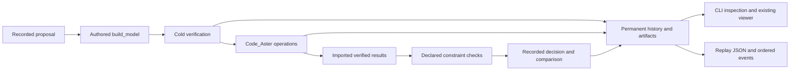

# Retained piping search

`tuba.search` connects authored model generation, cold verification, real
Code_Aster evaluation and processed-result review. It retains rejected layouts
and their reasons so the search can be reviewed and improved later. The initial
strategy is a deterministic sequential parameter grid.



## Author a search project

A project contains `model.py`, `study.py` and `search.py`.

`model.py` defines `build_model(parameters)` returning a fresh model, and binds
`model = build_model(DEFAULT_PARAMETERS)` for ordinary project/studio loading.
Use readable engineering constants and procedural builders. Search never edits
this script or writes a flat node script in its place.

`study.py` uses the existing `LOAD_CASES`, `SOLVER_OPTIONS` and optional
`VOLUME_EXPORT`. `SEARCH_CHECKS` declares `CheckSpec` records:

```python
from tuba.search import CheckSpec

SEARCH_CHECKS = (
    CheckSpec("nozzle.force", "reaction_force", True, ("Hot",),
              ("node:N0",), 10000.0, "N", {}),
    CheckSpec("hot.clearance", "operating_clearance", True, ("Hot",),
              (), None, None, {"envelope_type": "bare", "clearance_m": 0.03}),
)
```

Use actual model targets. `reaction_force` uses the three translational reaction
components in N; moments do not enter that norm. `displacement` uses translation
in m. The default increment scope is `all`; `{"increments": "final"}` explicitly
limits a check to the final retained increment. Operating clearance covers the
whole model and declared obstacle/reference surfaces at displacement scale 1.
Declare insulation for each pipe when using insulation/clearance envelopes.
Unknown targets, missing components and unsupported coverage remain unknown.

Cold clearance uses one explicit `cold_clearance` policy. Mandatory cold-model
and per-operation evidence gates are added automatically and cannot be replaced.
Cold geometry uses native verification. A native clash's distance and penetration
retain the engine's meaning; a clear result does not invent a minimum distance.

`search.py` declares the grid and budgets:

```python
from tuba.search import SearchDefinition

SEARCH = SearchDefinition(
    {"width_m": (1.6, 2.4), "depth_m": (0.8, 1.8)},
    ("pipe_length_m", "bend_count", "support_count"),
    candidate_limit=4, max_solver_calls=8,
    max_artifact_bytes=512 * 1024 * 1024,
)
```

Axis names are sorted; values retain their authored order. The product is
checked against `candidate_limit` before enumeration. Selection compares the
declared objectives lexicographically, then proposal order for ties. All
proposals are recorded, including those deferred by a budget or runtime blocker.
Failed solver invocations consume the call budget; reuse does not. Byte limits
are checked at scheduling boundaries; already produced failure evidence is
preserved even when a solver attempt crosses the limit.

Project-local Python imports are frozen in the source inventory. Declare
additional conditional helper files as `SEARCH_DEPENDENCIES` and CAD/data files
as `SEARCH_ASSETS`, each a tuple of project-relative paths in `search.py`. Missing
inputs, links/reparse points and cache/build/archive directories are refused.

## Project-owned engineering checks

No piping-standard evaluator is built into search. A study may declare required
`user_evaluator` specs and implement `evaluate_search(context)` returning a tuple
of `CheckResult` records. The context contains `model`, `runs`, `check_specs`
and `candidate_id`. Results must use the requested IDs, operation/increment,
targets, required flags, units and limits. Engineering verdicts require evidence
inside that operation's verified native attestation. Missing evaluator output
remains unknown. `not_applicable` requires the same authored applicability
condition and a reason. FE stress summaries are descriptive solver fields,
not piping-standard compliance.

## Run, inspect and review

```powershell
python -m tuba.search run examples/piping-search --run-dir D:/tuba-runs/Tuba_v4/search-001
python -m tuba.search inspect --run-dir D:/tuba-runs/Tuba_v4/search-001
python -m tuba.search inspect --run-dir D:/tuba-runs/Tuba_v4/search-001 --candidate C0005
python -m tuba.search inspect --run-dir D:/tuba-runs/Tuba_v4/search-001 --json
python -m tuba.search review --run-dir D:/tuba-runs/Tuba_v4/search-001 --candidate C0005 --output D:/tuba-runs/Tuba_v4/search-001/exports/C0005
python -m tuba.visualization.viewer D:/tuba-runs/Tuba_v4/search-001/exports/C0005 --open
```

Use `review --attempt <ID>` to inspect an earlier retained retry. Solver setup or
execution failures are distinct from failed engineering constraints. All
required operations, checks and trusted evidence must be complete before a
candidate becomes feasible. `selected` additionally requires a recorded
comparison with the other feasible candidates. Feasible means that the declared
requirements passed under the model assumptions; it does not imply full design
approval.

CLI exit codes: 0 for valid inspection/export/review or a selected run; 2 for
invalid input/configuration; 3 for a finished run with no feasible layout; 4 for
a runtime/storage/history blocker. A missing Code_Aster runtime stops further
scheduling and is never presented as an engineering rejection.

With a Python-managed Code_Aster runtime on Linux/WSL, run the CLI from the
host environment that has Tuba's dependencies and select the separate solver
interpreter:

```bash
export TUBA_CODE_ASTER_EXEC_METHOD=python_bridge
export TUBA_CODE_ASTER_PYTHON=/path/to/code-aster-environment/bin/python
python -m tuba.solver.code_aster_doctor --check
python -m tuba.search run examples/piping-search --run-dir /path/to/retained-search
```

The bridge runs Code_Aster in an external process; the host environment does not
need to import Code_Aster. Runtime repair followed by `--resume` creates a new
attempt for a runtime-blocked candidate and retains the failed invocation.

## Retention, restart and replay

Each run owns an append-only SQLite history, frozen sources, candidate parameters
and derived model JSON, unique permanent attempt directories, and inventories of
available inputs, outputs and logs. An inventory proves retained bytes, not
solver execution. Code_Aster attestations retain their separate native trust
checks. Partial output survives exceptions and interruption.

Resume uses `run ... --resume` with the exact original source/configuration.
Recovery records orphan attempts as interrupted; retrying uses a new attempt ID.
For changed geometry, criteria or source, create a new run with
`--parent-run <old-run>`. Physical evidence is reused only for identical native
solver input identity, after integrity/trust checks and reimport against the
new candidate. New checks and decisions never replace old ones.

```powershell
python -m tuba.search export --run-dir D:/tuba-runs/Tuba_v4/search-001 --output D:/tuba-runs/Tuba_v4/search-001/exports/replay
```

The `tuba.search.replay.v1` manifest and `events.jsonl` preserve ordering,
candidate ancestry, every decision, scoped result IDs, geometry references,
collision locations, measurements/limits and hash/size availability diagnostics.
Result scope is `(candidate, attempt, operation, result_state)`, so repeated
native IDs remain unambiguous. Inspection/export require no solver or agent.
Export folders must be new. The manifest references the retained archive and is
not a self-contained copy; native review bundles are complete handoffs.

M1 provides these records and candidate reviews. M2 adds interactive replay in
the existing viewer. Film rendering, richer autorouting strategies and learned
proposal policies remain [roadmap milestones](../architecture/piping-search-roadmap.md).

## Interactive replay

Export a new viewer package from a retained search without an agent, new solve,
or execution of the authored project:

```powershell
python -m tuba.search replay --run-dir D:/tuba-runs/Tuba_v4/search-001 --output D:/tuba-runs/Tuba_v4/search-001/exports/viewer-replay
python -m tuba.visualization.viewer D:/tuba-runs/Tuba_v4/search-001/exports/viewer-replay --open
```

The Search history section steps through recorded events and UTC search time.
Until an evaluation is sealed, only its reference geometry is eligible. Later
checks and selection decisions do not appear at earlier event positions. Solver
result-state/increment remains a separate axis. Choose any candidate and sealed
attempt to inspect its own outcome; an interrupted attempt does not inherit a
successful retry's selection.

Parents are declared relationships. The parameter grid has independent roots;
replay does not invent ancestry between successive proposals. The comparison
selector shows parameter changes between roots or parents. Inspect the reference
candidate in the same viewport to compare geometry with a stable camera, unit
system and deformation display scale. Comparable magnitude fields use shared
ranges from the complete retained archive; these are display ranges, rather
than observations available to the search at the event cursor. Editing a shared
range carries it between candidates. Other field/components use native local
ranges.

Each finding shows the constraint, role, verdict, operation/state, targets,
measurement, limit and units. Show finding selects the exact native state and
candidate-local objects; a cold finding opens reference geometry. Collision
distance, penetration and location retain their native meaning and physical
scale-1 basis. Evidence links open files inside that attempt's native bundle.
Missing/damaged evidence disables its result view while preserving the recorded
historical decision and diagnostics. A historical pass is not requalification of
damaged evidence.

Malformed inventory records remain visible as availability diagnostics; readable
candidates continue to open. Crash-recovered sealed attempts appear independently
from published evaluations, with their archived artifact availability and no
inferred checks or decisions. Missing transferred scenes clear the viewport and
leave the history accessible. Static replay reports contain native evidence and
checks; decision labels belong to the event cursor in the Search panel.

The package contains `search_replay.json`, the M1 history export, previews and
complete native per-evaluation review bundles. All candidate records remain,
including builder failures with no scene. The history manifest still references
the original archive for files not carried in native review bundles; retain that
archive for a complete audit. No archive or authored project bytes are modified.

Source-checkout users must select a viewer build that includes M2. Older packaged
assets are refused with a clear requirement. Use the repository viewer build
workflow and point `TUBA_VIEWER_ASSETS` at its output:

```powershell
$env:TUBA_VIEWER_ASSETS = 'D:/path/to/current-viewer-build'
python -m tuba.visualization.viewer D:/path/to/viewer-replay --open
```

The measured M2 handoff is
`D:/tuba-runs/Tuba_v4/search-replay-m2-20261010`: `package/`, a read-only
`viewer-build/`, `build-viewer.mjs`, `serve.py` and browser screenshots/validation.
This focused viewer build reuses the existing renderer and npm dependencies; it
omits the browser-Python authoring payload, which replay does not use. To open it:

```powershell
$env:TUBA_VIEWER_ASSETS = 'D:/tuba-runs/Tuba_v4/search-replay-m2-20261010/viewer-build'
python -m tuba.visualization.viewer D:/tuba-runs/Tuba_v4/search-replay-m2-20261010/package --open
```

Final M2 validation passed **726 viewer unit checks**, **86 Python checks**
(one Windows symlink-permission skip), and **10 real-archive browser scenarios
with zero page errors**. Those scenarios
covered all 12 candidates, Hot clearance and nozzle-force rejections with native
downloads/highlights, C0009 selection, its interrupted retry, cold geometry,
parameter comparison, event causality, a pre-selection report, cold-after-hot
finding scope and delayed/rapid switching. Python regressions also covered malformed
inventories, missing authored-source records, native crash recovery followed by
retry, and missing/malformed transferred scenes. One controlled
1200 ms response delay exercised UI ordering; it did not alter solver artifacts.
The real Code_Aster 18.0.12 evidence is from M1's original qualification. M2
performed no new physics solve.

The fresh final review, regression failures/passes, native payload hash checks,
current source revision, viewer build identity and measured storage are retained
in `qualification.json` and `validation/`. Proposal `intent` remains inspectable
in the archive; displaying it directly in the panel is deferred presentation
polish. Every recorded rejection/check/decision explanation is available.

The [hot-line example](../../examples/piping-search/README.md) provides the
bounded authored benchmark and opt-in real Code_Aster qualification test.

## Recorded search film (M3)

From a source checkout with the existing viewer npm dependencies, select a current
viewer build and an existing FFmpeg executable with VP8 support:

```powershell
$env:TUBA_VIEWER_ASSETS = 'D:/path/to/current-viewer-build'
python -m tuba.search film --replay-dir D:/path/to/viewer-replay --output D:/path/to/new-film --ffmpeg C:/path/to/ffmpeg.exe
```

`--start 100 --end 160` selects an inclusive search-event range. The default
`iterations` policy follows tested layouts, with their changed parameters,
recorded outcome, all failure locations for the same operation/state, support
forces and moments, and pipe stress shown together. It holds each view for eight
seconds and writes `index.html` with iteration chapters. Interrupted attempts
appear before their retries; final selection appears after all tests. Repeated
objective decisions do not replay the same test as a new iteration.

`--events milestones` shows builds, sealed evaluations, recovery/diagnostics and
decisions; `--events all` includes every recorded event. `--events review` retains
the detailed result-field tour. In these detailed policies, failed and unknown
checks receive separate frames with exact recorded measurements, collision
details, targets and load/state. `--hold-seconds 8 --fps 25 --width 1600 --height 900`
sets presentation timing and size. It does not reproduce elapsed solver time.
The output must be new and outside the replay package.

The export contains `film.webm`, `captions.vtt`, unique `frames/F*.png` and
`film.json`. Each keyframe records its event sequence/time, candidate,
evaluation/attempt, check index and complete check/evidence references, actual
displayed operation/state, camera, viewer identity, PNG hash and encoded frame
range. The movie and replay manifest have hashes too. Retain the replay package
and native archive alongside the film for inspection; the movie does not copy or
replace those artifacts.

Capture uses the existing Three.js viewer at fixed SI units and visual
deformation scale 1, with a common segment envelope and the replay's labelled
comparison colour ranges. Captions distinguish search time from solver state.
Views are held and cut without creating interpolated engineering states. Missing
scenes are visibly unavailable with the previous scene cleared; failed capture
keeps a `status: failed` manifest and aborts. Interrupted/recovered attempts never
inherit a later successful evaluation or selection.

This first format is WebM/VP8. MP4 conversion, narration and creative editing are
separate work. Missing Node, Playwright, current viewer assets or FFmpeg stops
capture with a runtime requirement; nothing is installed automatically. Installed
wheels without the source capture script require a source checkout.

M3 qualification and reproducible helper scripts are retained in
`D:/tuba-runs/Tuba_v4/search-film-m3-20261011`. They capture the existing M1
Code_Aster evidence through the CLI, check native hashes, exercise Hot/cold scope,
the interrupted retry, unavailable geometry and fixed presentation, and decode
representative movie frames. This is film/replay qualification with zero new
physics solves. The recorded benchmark is a deterministic grid search; the film
does not claim that a new agent searched or provide hidden agent reasoning.

## Measured qualification

On 2026-10-10, the fixed example ran through Code_Aster **18.0.12** using the
Python-managed external bridge. The Tuba host used Python 3.12.3 on WSL Ubuntu;
the solver environment used Python 3.14.6. Portable validation used the existing
Windows environment: **175 passed, 1 skipped** (Windows symlink permission) in
the final search and adjacent native checks.
The real integration test passed, including native attestations, complete
Sustained/Hot results, selected-candidate review and inspection/export with solver
access disabled.

The final review added regressions for per-state evaluator target coverage,
unsupported cold obstacle coverage, and the two restart gaps between geometry,
evaluation and decision publication. All four findings were fixed. The corrected
acceptance adapters also rechecked all 12 retained benchmark candidates using
their verified native artifacts; every outcome matched with zero new solver
calls. The original real integration and final acceptance recheck retain their
separate source provenance.

| Recorded outcome | Candidates |
| --- | --- |
| Cold-clearance rejection, no solve | C0001–C0004 |
| Hot operating-clearance rejection, both operations solved | C0005–C0006 |
| Hot nozzle-force rejection, both operations solved | C0007–C0008 |
| Selected, every required demonstration check passed | C0009 |
| Feasible alternatives retained after comparison | C0010–C0012 |

There were **12 proposals and 16 fresh operation calls**. C0009 uses a 1.6 m
wide, 1.8 m deep loop and end guides. Its pipe length is 11.170796326794896 m
with four bends and four supports. C0010 has the same objective values and is
retained as an alternative; proposal order resolves that tie. Force margin is
not a declared selection objective.

The durable archive is `D:/tuba-runs/Tuba_v4/search-qualification-20261010-03`.
It contains `qualification.json`, the database, frozen sources, all trials,
`exports/selected-review`, `exports/rejected-C0005`, and `exports/replay`.
The manifest records exact source/check digests, Git provenance, interpreter
paths, test logs and measured storage/free space.

Two earlier diagnostic archives remain alongside it. Native validation caught
overlapping restraints in run 01; a direct support-state test caught the
held-axis mask error in run 02. Those boundary assumptions were corrected in a
fresh run without changing the clearance, force or displacement limits. Run 03
was interrupted to repair repeated unrelated cache verification and resumed
against its unchanged frozen source/configuration; the interruption and both
logs are retained. Every completed operation used real Code_Aster evidence.

These results qualify this declared benchmark and M1 workflow. M2 replay is
qualified separately above. Broader routing, support/contact physics,
piping-standard evaluators remain separate roadmap work. Film capture is described
and qualified separately above.

For the corrected drawing layout, on-drawing failure annotations and native
reaction/section-force/displacement views, see
[film readability](../architecture/piping-search-film-readability.md).
Use `--events iterations --hold-seconds 8` for the iteration-first movie.
Use `--events review --hold-seconds 5` for a detailed result-field review.
