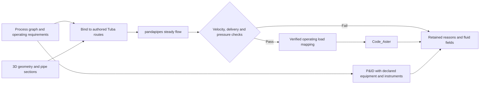

# Process networks, pandapipes and pipe stress

Tuba can evaluate a small serial water circuit with pandapipes, transfer its
verified operating conditions into Code_Aster, and retain each proposed layout
in the existing search review. The process graph and procedural 3D model are
separate authored inputs connected by stable route and component IDs. The graph
also supplies a P&ID with declared equipment and instruments, linked to the same
route and results.



## Open the authored project in Studio

The [authored model](../../examples/process_network/model.py) and
[study](../../examples/process_network/study.py) form an ordinary Studio
project. Install the optional `process` dependency in the same Python
environment as Tuba and configure the existing Code_Aster runtime as described
in [Setup](setup.md). From the checkout:

```powershell
python -m pip install '.[process]'
python -m tuba.solver.code_aster_doctor --check
python -m tuba.cli_studio examples/process_network `
  --out 'D:\tuba-runs\Tuba_v4\my-process-studio'
```

Keep the output outside the checkout. For a separate working project, copy
only `model.py` and `study.py` to a new folder and launch that folder with the
same command. These two source files depend only on installed Tuba; they need
no import from the checkout's `examples` package. Solver evidence belongs to
that working project; copying historical build output is unnecessary.

1. In **Build**, choose **P&ID**. The declared tanks, pipe, valve, instruments
   and signals are visible before either solver runs. Measured flow and pressure
   read **Not evaluated** until hydraulic evidence exists. Selecting `L-101`
   or its transmitter taps links to the physical route.
2. Choose **Run hydraulics**. Studio runs pandapipes for the current bound
   graph, geometry, scenario and requirements. The status becomes **Passed** or
   **Rejected**, and the actual fluid fields and localized check failures become
   available. Runtime failure is reported as **Failed** with its diagnostic.
3. After a passing, current hydraulic run, choose **Solve**. Studio maps
   verified pressure, filled-bore contents weight and the declared steady wall
   temperature onto a copy, then evaluates `WaterOperating` with Code_Aster.
4. Open **Review** after Code_Aster completes. The same P&ID remains available
   alongside imported stress, displacement and reaction results. Hydraulic
   rejection keeps its measured fluid values and leaves structural results
   unevaluated.

Edit `PIPE_SIZE = "larger"` or `OFFSET_M = 1.0` near the end of `model.py`.
The size chooses explicit outside diameter and wall thickness; the hydraulic
bore is measured from that section. `"small"` is the smaller-bore trial used to
exercise hydraulic rejection. After an editor change, choose **Run model.py**
to apply it, then **Run hydraulics** and **Solve** again. Pending editor text
does not change the last executed P&ID. Geometry, graph, scenario, requirements
or study edits invalidate dependent evidence; stale results cannot enable
structural Solve. A restart requires a fresh hydraulic run before process
loads can be reused.

The cold authored `model` has no `WaterOperating` loads. The separate `process`
global is a `BoundProcessNetwork`; its scenario ID matches the study's single
`LOAD_CASES = ("WaterOperating",)`. The study explicitly selects
`TUYAU_3M` and
`WALL_TEMPERATURE_MODEL = "bulk-fluid-equals-wall-steady"`. This is a
caller-declared steady approximation, not a pipe-wall heat-transfer solve.
The [Studio integration plan](../architecture/studio-process-integration.md)
records the lifecycle and acceptance checks.

## Run the retained-candidate campaign

The [authored model](../../examples/process_network/model.py) starts with no
external P&ID file. It defines a mass-flow source, an offset pipe, a downstream
restriction and a pressure sink. Explicit P&ID declarations identify the
boundaries as tanks and the restriction as a control valve at an illustrative
fixed-loss operating point. Tank dynamics, valve characteristics and control
response are not simulated. The valve is outside the mechanical pipe's outlet
anchor; its body mass, stiffness and equipment loads are outside this structural
study.

```powershell
python -m pip install '.[process]'
$env:TUBA_CODE_ASTER_EXEC_METHOD = 'wsl'
$env:TUBA_CODE_ASTER_WSL_DISTRO = 'Ubuntu'
python -m examples.process_network.run `
  --output 'D:\tuba-runs\Tuba_v4\my-process-study'
```

Use a new output directory outside the checkout. The `process` extra installs
the pinned pandapipes Python dependency; a packaged application can include it.
No external hydraulic compiler or OpenModelica installation is required.
Code_Aster uses Tuba's existing runtime configuration; the WSL distribution
above is a local installation choice.

For the optional OpenModelica comparison, pass `--backend openmodelica`. It
requires an installed compiler and MSL 4.1.0. `--omc PATH`, `TUBA_OMC` and PATH
discovery remain supported; passing `--omc` alone selects OpenModelica for
compatibility with earlier commands. `--backend pandapipes --omc PATH` is refused.

The default run proposes a smaller bore, a larger bore, then a longer offset.
It retains raw hydraulic inputs/results, solver/dependency identities,
mapping records, Code_Aster artifacts and native search history. Runtime failure
stops further scheduling and retains diagnostics. Hydraulic rejection keeps its
measured fluid results and leaves structural checks unevaluated.

Open `replay/search_replay.json` with Tuba's existing search viewer:

```powershell
python -m tuba.visualization.viewer 'D:\tuba-runs\Tuba_v4\my-process-study\replay'
```

The review offers fluid velocity, mean absolute pressure, element pressure drop
and bulk temperature, labeled with the actual hydraulic solver. Solved candidates additionally
carry Code_Aster support forces/moments, internal forces, displacement and FE
stress. Fluid pressure means and element drops are derived from the actual
evaluated endpoint pressures. They are not structural stress fields.

## Generate and inspect the P&ID

The review's **Process schematic** section generates its drawing from the
retained typed graph and optional `PidDefinition`. The example explicitly declares these equipment and instrument
identities; they are not inferred from its calculated pressures or flow:

| P&ID tag | Graph association | Meaning in this example |
| --- | --- | --- |
| `TK-101` | `SRC-101` | Supply tank, represented by prescribed mass flow and temperature. |
| `TK-102` | `SNK-101` | Receiving tank, represented by prescribed absolute pressure. |
| `FCV-101` | `V-101` | Control valve, represented by an illustrative fixed loss coefficient of 5. |
| `PT-101` | `L-101.in` | Pressure transmitter tap at the pipe inlet; displays calculated absolute pressure. |
| `FT-101` | `L-101.out` | Flow transmitter tap at the pipe outlet; displays calculated mass flow in kg/s. |
| `FIC-101` | `FT-101` -> `FCV-101` | Declared flow indicating controller and electrical signal path; no calculated controller output. |

The drawing uses solid process connections and instrument taps, instrument
bubbles, a panel controller and dashed electrical signals, explained by its
legend. The controller does not move the valve in pandapipes. The 10 kg/s flow
is prescribed by the scenario; the valve's `K=5` is a chosen operating-point
assumption, not a catalogue characteristic or a sizing result. Displayed
transmitter values are calculated results, not readings from physical sensors.
The symbol convention is documented by the legend; no standards-compliance
claim is made.

Select a component or instrument to inspect its declared association and
available results. Pipe and pipe-tap selection links to the corresponding
mechanical route. Equipment selection resolves to its graph component; tanks
and the external valve have no structural elements in this example. A
controller has no fabricated numerical output. A hydraulically rejected
candidate keeps its drawing, localized failures and measured fluid results,
while structural results remain unevaluated.

Choose **Open P&ID** to inspect the drawing at full size, or **Download SVG**
for sharing and vector editing. The authored Python graph remains the source
for engineering changes. Editing SVG text or moving a symbol does not change
Tuba topology, geometry or simulation inputs. Drawing coordinates are never
used as physical dimensions.

### Author the declarations in Python

When creating a `ProcessNetwork`, pass `pid=PidDefinition(...)`. To add the
example's declaration to an existing network with components `SRC-101`,
`L-101`, `V-101` and `SNK-101`:

```python
from dataclasses import replace
from tuba.process import EquipmentDefinition, Instrument, PidDefinition, SignalConnection

network = replace(network, pid=PidDefinition(
    equipment=(
        EquipmentDefinition("TK-101", "SRC-101", "tank", "Supply tank; prescribed flow"),
        EquipmentDefinition("TK-102", "SNK-101", "tank", "Receiving tank; prescribed pressure"),
        EquipmentDefinition("FCV-101", "V-101", "control_valve", "Illustrative fixed K=5; no valve curve"),
    ),
    instruments=(
        Instrument("PT-101", "PT", "L-101.in", "Calculated inlet absolute pressure"),
        Instrument("FT-101", "FT", "L-101.out", "Calculated outlet mass flow"),
        Instrument("FIC-101", "FIC", None, "Declared flow control; not simulated"),
    ),
    signals=(SignalConnection("FT-101", "FIC-101"),
             SignalConnection("FIC-101", "FCV-101")),
))
```

Definitions validate before binding or solver execution. Equipment and
instrument tags must be unique; component and tap-port references must exist.
`PT`/`FT` taps require a process port, while `PIC`/`FIC` controllers have none.
A controller needs one compatible transmitter input and one declared control
valve output; signal direction and quantity must match. Equipment type
annotations do not add pump curves, heat transfer, tank levels or mechanical
bodies to the numerical model. An LLM must declare missing design inputs
explicitly rather than infer them from results.

Existing graphs without `pid` continue to show the tagged process schematic.
Imported graphs receive no invented equipment or instrumentation. Re-export
an intact retained campaign to refresh its supported drawing without modifying
the archived evidence, using a new output directory:

```powershell
python -m tuba.search replay `
  --run-dir 'D:\tuba-runs\Tuba_v4\my-process-study' `
  --output 'D:\tuba-runs\Tuba_v4\my-process-study-review'
```

This reuses the archived solver evidence; it is not a new hydraulic or
Code_Aster evaluation. P&ID declarations participate in the bound input
fingerprint: authoring or changing them requires a new candidate, rather than
adding tags to a sealed old run. New geometry or operating inputs also require
new solves. See the [review vision](../architecture/process-model-review-study.md)
and [implementation plan](../architecture/process-pid-implementation-plan.md).

## Import one real P&ID connection

The optional adapter reads **DEXPI XML 2.0.1**. The bundled, unmodified
[official reference fixture](../../examples/process_network/dexpi_reference/README.md)
contains a suitable connection: line `47122`, segment `PipingNetworkSegment2`,
pipe `Pipe2`, between pump `P4711` and heat exchanger `H1007`.

```powershell
python -m examples.process_network.run `
  --dexpi examples/process_network/dexpi_reference/reference_pid.xml `
  --segment PipingNetworkSegment2 `
  --output 'D:\tuba-runs\Tuba_v4\my-dexpi-study'
```

This reuses the same coupled evaluation and review. It tests two authored offset
routes while keeping the imported DN80 connection fixed. The example maps DN80
to its explicit 88.9 mm OD / 5.49 mm wall section; it refuses undeclared changes
to a smaller nominal size. A nominal diameter alone does not determine bore.

The imported connection establishes **topology and source identity**. Its
`Nozzle2` / `PipingNode3` and `Nozzle3` / `PipingNode4` are explicit study
boundaries. Flow, temperature and outlet pressure are supplied by the demo;
pump and heat-exchanger behavior are outside those boundaries. The original
fluid code is `MNb`: water is an explicit demonstration substitution, not an
inferred original service. The physical route, section, steel properties,
supports, roughness and bend losses are also supplied engineering assumptions.
P&ID drawing coordinates never become physical pipe dimensions.

Every attempt retains the exact XML bytes, source SHA-256, original tags/IDs,
port associations, omitted-object inventory, assumptions and measured route
binding. A detached review includes `artifacts/process/process_input.xml` and
`process_import.json`, including when the fluid runtime fails. The review's
process-import table exposes those assumptions and source references.

The reusable entry point is `tuba.process.import_dexpi_segment`. It requires
an explicit segment ID, route ID, roughness, bend-loss data and declarations
for boundary conditions, physical layout and fluid service. The returned
`DexpiImport.network` binds through the existing process API; pass the import
object as `process_import=` to `evaluate_process_candidate` to retain it.
Adapter ports such as `Pipe2.in` are labeled aliases, with the original
DEXPI endpoint IDs preserved separately.

Only a selected segment containing one pipe between two nozzle boundaries is
supported. Extra selected equipment, branches, missing/conflicting references,
duplicate IDs and other DEXPI dialects fail explicitly. The rest of the plant
remains recorded as outside the selected study. The importer validates this
profile and never fetches schemas/imports; it does not claim full DEXPI semantic
validation. The bundled official fixture was separately checked against its
pinned XSD. DEXPI 1.x Proteus XML is a different format and is unsupported here.

## The reusable boundary

`tuba.process.network` defines `ProcessNetwork`, typed components/connections,
`OperatingScenario`, `HydraulicRequirements` and `BoundProcessNetwork`.
`network.bind(model, scenario, requirements)` measures actual pipe sections,
straight lengths, circular bend arcs, elevations and station ranges. Splitting
a route for a support does not invent a P&ID junction. The graph validates
connectivity and rejects unsupported branches, cycles and implicit reducers.

```python
from tuba.process import PandapipesBackend, apply_fluid_loads

bound = network.bind(model, scenario, requirements)
fluid = PandapipesBackend().solve(bound, fresh_output_directory)
mapping = apply_fluid_loads(
    model, bound, fluid,
    operation_name="WaterOperating",
    wall_temperature_model="bulk-fluid-equals-wall-steady",
)
run = model.solve(operation=mapping.operation.name, work_dir=aster_directory)
# Publish using build_visualization_scene(SceneRequest(model, analysis_runs=[run])).
```

The mapper checks the current geometry, scenario and unchanged solve-issued
artifacts before changing an operating case. Geometry/bore/loss/scenario edits
require rebinding and a new fluid solve. Existing operations are preserved;
name collisions fail. JSON network records round-trip strictly. Hydraulic
`to_dict()` is a reporting record, not an API for importing arbitrary numbers as
qualified results.

The load mapping uses evaluated element endpoint pressure means minus external
absolute pressure, fluid density for filled-bore contents weight, and kelvin
converted to Celsius. Equating steady bulk temperature and pipe-wall temperature
is an explicit caller-selected approximation. Pressure acts through Tuba's
existing Code_Aster pressure formulation exactly once. No extra hand-authored
nozzle thrust, bend momentum force or friction load is silently added.

## Giving the evaluation loop to an LLM

An LLM can propose edits through the same bounded JSON input as a person:

```json
[
  {
    "id": "proposal-1",
    "parent_ids": [],
    "parameters": {"size": "larger", "offset_m": 2.0},
    "intent": "Test whether the longer offset reduces the anchor reaction"
  }
]
```

Run with `--proposals proposals.json`. Only `size` (`small`/`larger`) and
`offset_m` (0.5–4 m) are permitted in this example, with at most ten proposals.
Each revision needs a new ID; parents must precede children in the same run.
Read `summary.json` and the retained checks before proposing a revision. An
appropriate agent instruction is:

> Preserve process connectivity, operating requirements and endpoint locations.
> Change only the permitted parameters. Explain the intended physical effect.
> Evaluate every proposal through the coupled runner. Use measured failures to
> choose the next edit. A runtime failure or missing check is unresolved, not a
> pass. Do not invent solver values or lower requirements to obtain acceptance.

`evaluate_process_candidate` reuses the native search evaluator, evidence
inventory, checks, decisions and review exporter. Required fluid failures stop
the structural solve. Actual structural failures retain their Code_Aster
results for review. This supplies an evaluation tool for LLMs; it is not a
controlled model-provider benchmark or an autonomous optimizer.

## Current scope and next work

The supported subset is forward, fully filled, steady serial liquid water,
273.15–353.15 K and evaluated absolute pressures of 0.1–10 MPa. The explicit
constant-property water model retains the same values as the earlier
`Modelica.Media.Water.ConstantPropertyLiquidWater` study: density 995.586 kg/m³
and viscosity 0.001 Pa s. These are constant assumptions, including at the
example's 60 °C, rather than a temperature-dependent water-property calculation.
Pandapipes uses Prandtl-Colebrook friction and currently requires pipe Reynolds
numbers of at least 4,000. Lower-flow regimes fail explicitly; they are not
qualified by this adapter. Bulk temperature is prescribed uniformly: the
adapter runs isothermal hydraulics and does not solve heat transport.
The optional OpenModelica backend keeps its own
friction formulation and validity checks.
Bend and fixed-loss coefficients require a declared source or assumption; the
example uses illustrative values, not qualified equipment catalogue data.

Mechanical pressure is constant within each authored pipe element. Split and
reevaluate a route when its pressure gradient requires more resolution.
One-way pressure/temperature/contents transfer does not qualify water hammer,
flow-induced vibration, external-pressure collapse or general fluid-structure
interaction. Example force/displacement limits are illustrative and FE stress
display does not establish a piping-code check.

Next: qualify valve/pump data and branched-network cases, improve candidate
comparison, and extend the declared DEXPI exchange profile. Dynamic controls,
valve sizing, a graphical P&ID editor and SVG-to-model round-tripping are outside
the current instrumented drawing subset. Compare bounded LLM proposal policies
with recorded provider/model/version/costs. Modelica/FMU integration, transients and wall
thermal dynamics remain optional later stages. See the
[roadmap](../architecture/process-network-and-code-aster-roadmap.md).
