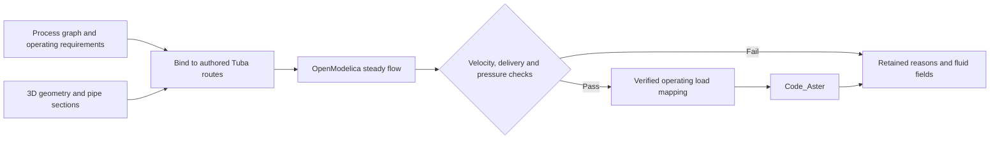

# Process networks, Modelica and pipe stress

Tuba can evaluate a small serial water circuit with OpenModelica, transfer its
verified operating conditions into Code_Aster, and retain each proposed layout
in the existing search review. The process graph and procedural 3D model are
separate authored inputs connected by stable route and component IDs.



## Run the small example

The [authored model](../../examples/process_network/model.py) starts with no
external P&ID file. It defines a mass-flow source, an offset pipe, a downstream
restriction and a pressure sink. The restriction is explicitly outside the
mechanical pipe's outlet anchor; its body mass, stiffness and equipment loads
are outside this structural study.

```powershell
$env:TUBA_CODE_ASTER_EXEC_METHOD = 'wsl'
$env:TUBA_CODE_ASTER_WSL_DISTRO = 'Ubuntu'
python -m examples.process_network.run `
  --omc 'C:\Program Files\OpenModelica1.27.0-dev-64bit\bin\omc.exe' `
  --output 'D:\tuba-runs\Tuba_v4\my-process-study'
```

Use a new output directory outside the checkout. The compiler path and WSL
distribution are local installation choices. `OpenModelicaBackend` also accepts
`TUBA_OMC` or discovers `omc` on PATH; Code_Aster uses Tuba's existing runtime
configuration. No additional Python bridge dependency is required for Modelica.
MSL 4.1.0 must be installed: the generated script requests that exact version.

The default run proposes a smaller bore, a larger bore, then a longer offset.
It retains raw fluid CSV, generated Modelica inputs, compiler/library identities,
mapping records, Code_Aster artifacts and native search history. Runtime failure
stops further scheduling and retains diagnostics. Hydraulic rejection keeps its
measured fluid results and leaves structural checks unevaluated.

Open `replay/search_replay.json` with Tuba's existing search viewer:

```powershell
python -m tuba.visualization.viewer 'D:\tuba-runs\Tuba_v4\my-process-study\replay'
```

The review offers fluid velocity, mean absolute pressure, element pressure drop
and bulk temperature, labeled **OpenModelica**. Solved candidates additionally
carry Code_Aster support forces/moments, internal forces, displacement and FE
stress. Fluid pressure means and element drops are derived from the actual
evaluated endpoint pressures. They are not structural stress fields.

## The reusable boundary

`tuba.process.network` defines `ProcessNetwork`, typed components/connections,
`OperatingScenario`, `HydraulicRequirements` and `BoundProcessNetwork`.
`network.bind(model, scenario, requirements)` measures actual pipe sections,
straight lengths, circular bend arcs, elevations and station ranges. Splitting
a route for a support does not invent a P&ID junction. The graph validates
connectivity and rejects unsupported branches, cycles and implicit reducers.

```python
bound = network.bind(model, scenario, requirements)
fluid = OpenModelicaBackend().solve(bound, fresh_output_directory)
mapping = apply_fluid_loads(
    model, bound, fluid,
    operation_name="WaterOperating",
    wall_temperature_model="bulk-fluid-equals-wall-steady",
)
run = model.solve(operation=mapping.operation.name, work_dir=aster_directory)
# Publish using build_visualization_scene(SceneRequest(model, analysis_runs=[run])).
```

The mapper checks the current geometry, scenario and unchanged solve-issued
artifacts before changing an operating case. Geometry/bore/loss/scenario edits
require rebinding and a new fluid solve. Existing operations are preserved;
name collisions fail. JSON network records round-trip strictly. Hydraulic
`to_dict()` is a reporting record, not an API for importing arbitrary numbers as
qualified results.

The load mapping uses evaluated element endpoint pressure means minus external
absolute pressure, fluid density for filled-bore contents weight, and kelvin
converted to Celsius. Equating steady bulk temperature and pipe-wall temperature
is an explicit caller-selected approximation. Pressure acts through Tuba's
existing Code_Aster pressure formulation exactly once. No extra hand-authored
nozzle thrust, bend momentum force or friction load is silently added.

## Giving the evaluation loop to an LLM

An LLM can propose edits through the same bounded JSON input as a person:

```json
[
  {
    "id": "proposal-1",
    "parent_ids": [],
    "parameters": {"size": "larger", "offset_m": 2.0},
    "intent": "Test whether the longer offset reduces the anchor reaction"
  }
]
```

Run with `--proposals proposals.json`. Only `size` (`small`/`larger`) and
`offset_m` (0.5–4 m) are permitted in this example, with at most ten proposals.
Each revision needs a new ID; parents must precede children in the same run.
Read `summary.json` and the retained checks before proposing a revision. An
appropriate agent instruction is:

> Preserve process connectivity, operating requirements and endpoint locations.
> Change only the permitted parameters. Explain the intended physical effect.
> Evaluate every proposal through the coupled runner. Use measured failures to
> choose the next edit. A runtime failure or missing check is unresolved, not a
> pass. Do not invent solver values or lower requirements to obtain acceptance.

`evaluate_process_candidate` reuses the native search evaluator, evidence
inventory, checks, decisions and review exporter. Required fluid failures stop
the structural solve. Actual structural failures retain their Code_Aster
results for review. This supplies an evaluation tool for LLMs; it is not a
controlled model-provider benchmark or an autonomous optimizer.

## Current scope and next work

The supported subset is forward, fully filled, steady serial liquid water,
using `Modelica.Media.Water.ConstantPropertyLiquidWater`, 273.15–353.15 K and
evaluated absolute pressures of 0.1–10 MPa. Fluid properties are constant in
this selected medium, including at the example's 60 °C operating temperature.
Bend and fixed-loss coefficients require a declared source or assumption; the
example uses illustrative values, not qualified equipment catalogue data.

Mechanical pressure is constant within each authored pipe element. Split and
reevaluate a route when its pressure gradient requires more resolution.
One-way pressure/temperature/contents transfer does not qualify water hammer,
flow-induced vibration, external-pressure collapse or general fluid-structure
interaction. Example force/displacement limits are illustrative and FE stress
display does not establish a piping-code check.

Next: import one declared DEXPI version into this graph using a real fixture;
add qualified valve/pump data and branched-network cases; compare bounded LLM
proposal policies with recorded provider/model/version/costs. FMUs, controls,
transients and wall thermal dynamics remain later stages. See the
[roadmap](../architecture/process-network-modelica-and-code-aster-roadmap.md).
