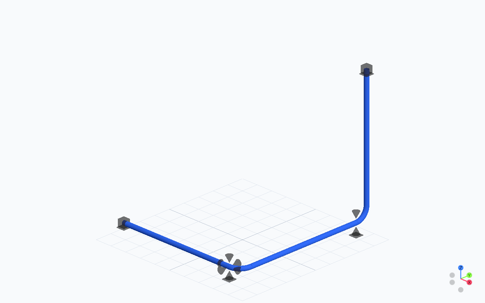

# Workflow

Tuba defines piping systems and their supporting structures in Python, evaluates them with Code_Aster, and displays the processed results:

```text
Tuba model -> verification -> Code_Aster solve -> imported artifacts -> result review
```



[](https://jgwagenfeld.github.io/Tuba_v4/viewer/?bundle=code-aster-review)

## Projects in Studio, the CLI and agents

Studio, CLI and MCP (Model Context Protocol) use the same project folder.

| File or folder | Purpose |
| --- | --- |
| `model.py` | Authored procedural Python defining geometry, materials, sections, supports and operations |
| `study.py` | `LOAD_CASES`, `SOLVER_OPTIONS` and optional analysis/review configuration |
| `units/` | Optional reusable construction functions |
| `geometry/` | Optional CAD and other model assets |
| `evidence/<operation>/` | Imported, attested Code_Aster artifacts |
| `search.py` | Optional retained-search parameters, objectives and budgets |

Authored Python remains the engineering definition. Studio and generated-script
tools preserve it; functions, engineering constants, loops and imports belong in
the source. See [Modeling](modeling.md) for construction units and
[Share and open a project](project-sharing.md) for source/CAD handoff.

### Studio

After [Setup](setup.md), launch the project chooser or a specific folder:

```bash
python -m tuba.cli_studio
python -m tuba.cli_studio examples/multipipe-rack
```

The chooser provides **Open Folder**, **New Project** and **Recent Projects**.
**Projects** returns to it. Open preserves authored files; New requires a new
or empty folder. Each full folder path gets its own bundle and server.
Opening a running project reuses its discovered URL, including a random port.

1. In **Build**, edit `model.py` and choose **Update geometry** (Ctrl+Enter).
   Local Studio saves and executes the source; external source changes reload
   automatically. Fix reported authoring and verification errors.
2. Select the case and **Solver .comm** to inspect generated, read-only
   Code_Aster input. This is a study preview, not a completed evaluation.
3. Choose **Solve** or **Solve all** for the study's operations.
4. Open **Review** after completion. **Colour by** selects the field;
   **Display** controls geometry and mesh visibility; **Tables & issues**
   contains reactions and findings; **Report** opens printable tables.

If the project declares a bound process network, run and pass **Run hydraulics**
before structural **Solve**. **P&ID** opens the drawing in Build and Review.
See [Process networks](process-networks.md#open-the-authored-project-in-studio).

Changes to source or study inputs mark dependent results outdated. Pending
editor text must be applied before solving. Studio saves compare the loaded
source revision; a conflict preserves the newer disk source and the unsaved
editor draft. Recent-project state is never an implicit target for MCP.

### CLI

Use the project CLI for scripts and batch evaluation:

```bash
python -m tuba.project examples/multipipe-rack --output .build/multipipe-review
```

The CLI uses `study.py` and checks matching attested evidence before reuse.
Add `--force` when you need a fresh solve. It only reruns otherwise reusable
evidence; it cannot bypass blocking verification. New results require the
configured Code_Aster runtime.

### MCP

Launch the local **stdio** server in the Tuba environment with the `mcp` extra:

```bash
python -m tuba.mcp.server
```

Configure the client to use that environment's Python executable, then bind
explicitly with `init_session(file_path="/path/to/project/model.py",
load_existing=True)`. Author procedural Python normally and use `inspect_model`,
`verify_model`, `check_clashes`, `save_unit`, `apply_unit` and `solve_model`
for inspection, verification, reusable units and evaluation.

Inspection reloads changed Python, helpers and CAD. Rebind before mutating
externally changed source; inspection alone does not authorize a rewrite.
MCP and CLI solves use the same study settings, project solve claim and attested
evidence. `solve_model(load_case=...)` validates the selected study operation
and evaluates all study operations together. An open Studio imports externally
promoted evidence into Review.

The `.tuba/studio.json` pointer advertises the local endpoint. It is accepted
only after checking the live server's folder and session identity. The adapter
uses the official MCP SDK; it is not a separate model format or solver.

#### Teach your agent the authoring contract

Tuba ships a modeling skill for coding agents:

```bash
python -m tuba.skills --list
python -m tuba.skills --target ~/.codex/skills
```

Use your client’s skills directory. The skill describes procedural authoring,
verification, fluent-builder bend semantics and route-endpoint checks.

## Execution sequence

1. Author through `model.pipe(...)` and other model APIs.
2. Run `model.verify()` and resolve its blocking errors. This combines
   structural validation, join-aware cold-model clashes and rules.
   `model.validate()` checks the structural subset.
3. Export the Code_Aster mesh, commands, runner handoff, manifest and sidecar.
4. Execute Code_Aster through the configured external-process runtime.
5. Import the produced CSV/RMED artifacts into a provenance-bearing
   `AnalysisRun`, with persistent `ResultState` and numerical `FEAResults`.
6. Build engineering review records and display them through one of the two
   visualization paths.

Studio, CLI and MCP apply the shared project verification gate before changing
staging or evidence. The gate also reports project-script findings.
Blocking findings prevent evaluation even with `--force` or
`solve_model(force=True)`; advisories remain visible.

The [Tutorial](tutorial.md) provides a complete runnable example. The staged
API keeps export, execution and import inspectable:

```python
from pathlib import Path
from tuba.solver.aster import CodeAsterSolver

verification = model.verify()
if not verification.passed:
    raise RuntimeError("\n".join(verification.errors))

solver = CodeAsterSolver(work_dir="runs/demo_hot")
study = solver.export_analysis_study(model, "Hot", Path("runs/demo_hot"))
run = solver.solve_exported_study(model, study)
```

Here `model` is an authored model with a `Hot` operation, and the runtime has
passed the [doctor check](setup.md). `model.solve("Hot")` is the convenience
path; both solve APIs return `AnalysisRun`. Export success is not solve success.
Missing or empty required result tables make the evaluation incomplete.

## Engineering review records

Reporting packages supplied records and does not run Code_Aster:

```python
from tuba.reporting import build_engineering_review, write_engineering_review

review = build_engineering_review(model, analysis_runs=[run])
write_engineering_review(review, "runs/demo_hot/review")
```

FE stress remains labelled `FE Von Mises (not piping-code stress)`.
The printable report starts with governing values across published cases,
including the case, entity and element end. Its model overview shows authored
centerlines and drawing keys mapped to exact element, node and support IDs.
Dimensioned SVG section plates show actual scheduled section geometry in mm.

Detailed tables can be expanded on screen and are included when printing.
JSON and CSV retain study and result-state lineage. Equilibrium checks compare
calculated applied loads with imported Code_Aster reactions in global axes,
with moments about `(0, 0, 0)` metres and explicit numerical tolerances.

Nodal loads, gravity (including insulation, contents and support masses), and
uniform line loads are covered for linear 1D studies. Loaded bends require the
authoritative analysis mesh. Pressure, wind, contact/load-path, cable,
spring/attached-support and volume/mixed studies state why balance is **not
evaluated** until complete recovery is available. Numerical balance is not a
design-code check.

## Exactly two visualization paths

Both paths consume imported Code_Aster results. Choose one per notebook or example.

### PyVista quick-look and export

`tuba/plotting/` is wired to `FEAResults.plot_*()`. It reads real `.rmed`
artifacts for notebook inspection and PLY, glTF and Blender export:

```python
run.results.plot_deformed_stress(
    deform_scale=40.0, model=model, jupyter_backend="html",
)
```

### Reviewable web scene

`tuba/visualization/` and `viewer/` provide shareable review bundles. Python
writes scene and review contracts; Three.js renders them:

```python
from tuba.visualization import SceneRequest, build_visualization_scene, write_scene_bundle

scene = build_visualization_scene(
    SceneRequest(model=model, analysis_runs=[run], include_analysis_mesh=True)
)
write_scene_bundle(scene, "runs/demo_hot/review_scene")
```

`write_engineering_review_with_scene(...)` puts tables beside that scene; it
does not create a third visualization path. Scene-only legacy bundles remain
displayable without implying that missing evidence exists. See
[visualization architecture](architecture/visualization.md).

## Mesh refinement and convergence

[STEP and meshing](step-meshing.md) covers authoring interfaces, units and
refinements. CLI and MCP use the same native worker as Studio:

```bash
python -m tuba.project.mesh mesh "/path/to/project" --output "/path/to/new-mesh-output"
python -m tuba.project.mesh convergence "/path/to/project" --output "/path/to/new-comparison-output"
```

MCP exposes `generate_mesh(output_dir=...)` and
`run_mesh_convergence(output_dir=...)`. Both require a new output folder.
Diagnostic meshes are unsolved; convergence requires the study configuration
and real Code_Aster, and independently verifies each level's artifacts.

In Build, Mesh review distinguishes requested-size preview, **Generate mesh**
(actual unsolved diagnostic cells) and **Run convergence** (verified solver
levels). Save sizing changes in Python, then regenerate. Source edits make old
artifacts stale. Geometric quality and measured solver changes do not establish
accuracy or compliance.

The [mesh-refinement example](https://github.com/jgwagenfeld/Tuba_v4/blob/main/examples/mesh-refinement-review/README.md)
includes sizing configuration, independent cantilever checks and a viewer-build
command for source checkouts.

## Browser geometry editing

Published examples accept `model.py` edits in **Build**. **Update geometry**
executes Python in the browser and displays an unsolved scene. **Review**
retains the published Code_Aster evidence and marks it outdated after edits.
Download the script and use local Tuba with Code_Aster for evaluation.
See [browser setup and limits](setup.md#try-a-model-in-the-browser).

## Publish a static review

From a source checkout with Tuba installed, solve the project, install the
packaged viewer into a dedicated web folder, then copy the completed review:

```bash
python -m tuba.project /path/to/project --output /path/to/project-review
python scripts/deploy_viewer.py viewer /path/to/web/tuba
python scripts/deploy_viewer.py bundle /path/to/project-review /path/to/web/tuba
```

The viewer shell is installed once; repeat `viewer` after a Tuba update and
`bundle` after each solve. The publisher also accepts a folder containing
`scene.json`, such as Studio's solved review output. It copies the complete
bundle, including the printable report and evidence. A replacement removes
stale files from that registered bundle and preserves other bundles and gallery
metadata. Publish one bundle at a time to each web folder.

Serve the folder with a static web server. For a local trial:

```bash
python -m http.server 8000 --bind 127.0.0.1 --directory /path/to/web/tuba
```

Open `http://127.0.0.1:8000/`. One registered bundle opens directly; several
show a gallery. `?bundle=<bundle-id>` opens a named review. The id is
`review.json`'s `package_id` without `review:`, and must be a safe folder name.
The publisher does not solve or provide Studio's authoring services.

To view an existing bundle with the packaged viewer:

```bash
python -m tuba.visualization.viewer /path/to/review_scene --open
```

## Geometry and model reports

Geometry and model attributes support physical envelopes, geometric clash
checks, quantity take-off, route cost, load-path reports, rules and BOM export
without a solve:

```bash
python -m examples.future_ready_semantic_workflow
```

These outputs describe the model. Operating-state checks require imported
Code_Aster results. [Retained piping search](piping-search.md) records candidate
evaluations and decisions; [Process networks](process-networks.md) adds hydraulic
evidence and its explicit structural load mapping.
